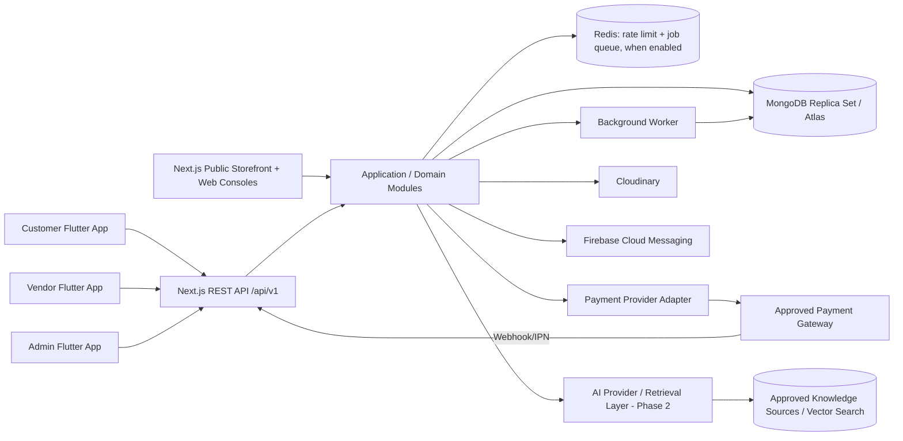
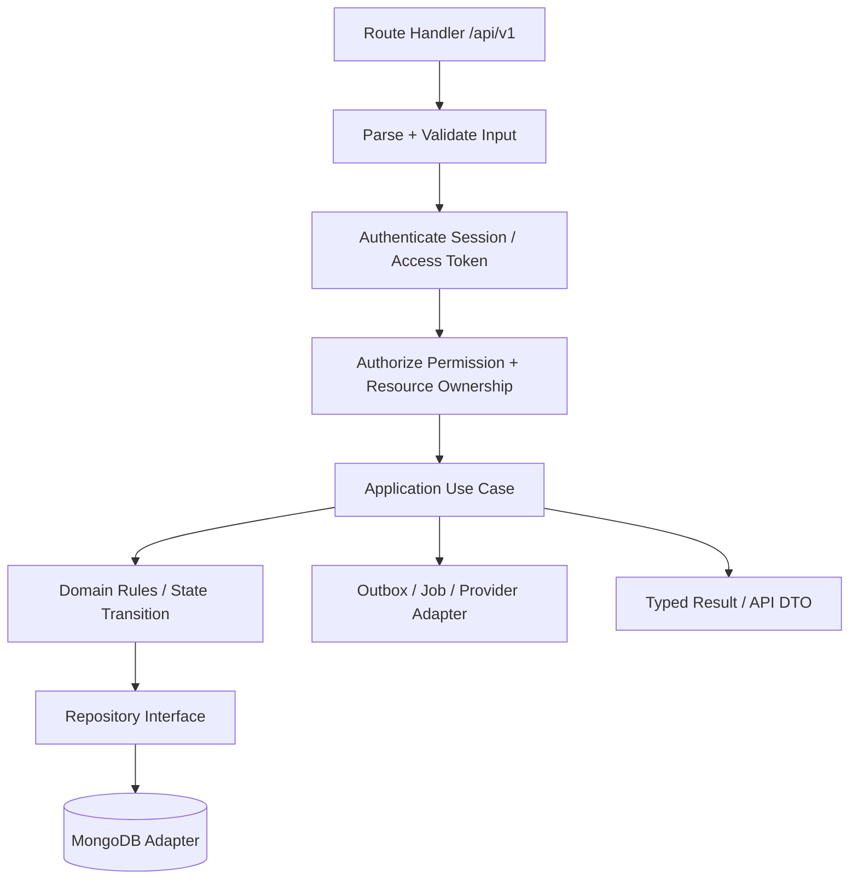
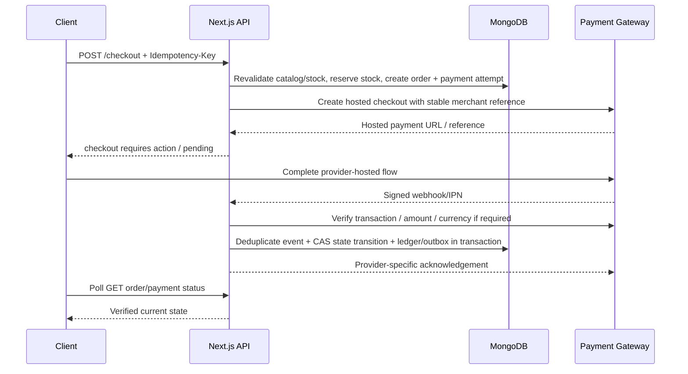
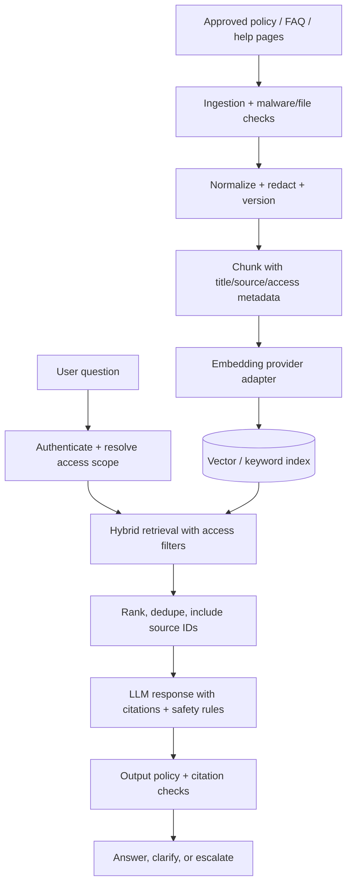

# Multi-Vendor Commerce Platform — Combined Blueprint

This file combines all documents in the pack. The canonical documents remain separate under `docs/`.


---

# Document: docs/01-product-requirements.md

# 01 — Product Requirements

## 1. Product vision

Build an independent, multi-vendor marketplace inspired by common capabilities in large commerce platforms: product discovery, vendor storefronts, variant/stock management, cart and checkout, split fulfillment, buyer protection/support, seller operations, moderation, analytics and a bounded AI help experience.

“Three roles” means three primary account roles — **Admin, Vendor and User/Customer** — not three security boundaries. Authorization must also check resource ownership, vendor approval, account status, action permissions and the target resource's state.

## 2. Product surfaces

| Surface | Audience | Purpose |
|---|---|---|
| Public storefront website | Guests and customers | SEO-first product/category pages, vendor stores, search, cart, checkout and account pages |
| Admin web console | Admin staff | Moderation, user/vendor management, catalog rules, order/payment/refund operations, reports and audit review |
| Vendor web console | Vendors | Store onboarding, catalog, SKUs, inventory, order fulfillment, returns and sales/settlement visibility |
| Customer Flutter app | Customers | Browse, search, cart, checkout, orders, reviews, notifications and support |
| Vendor Flutter app | Vendors | Manage products/stock, process orders, receive notifications and see reports |
| Admin Flutter app | Admin staff | Priority monitoring and limited operational actions; destructive/high-risk actions can require re-authentication or web-console confirmation |

The mobile apps are separate deliverables and application IDs, but can share maintained Dart packages. UI visibility does not grant permission; every API operation performs server-side authorization.

## 3. Roles and access model

### User/Customer
- Register, verify contact method, sign in/out, manage profile/address.
- Browse active products, variants, availability, seller profile and policies.
- Maintain cart and wishlist, apply eligible promotions, check out and select available delivery/payment methods.
- View customer order and per-vendor fulfillment status, request cancellation/return/refund within policy, review eligible purchases and contact support.

### Vendor
- Apply to sell and submit required business/identity details; application can be pending, approved, rejected, suspended or more-information-required.
- Manage only own vendor profile, eligible products, images, SKUs, inventory, prices and shipping settings.
- Review and fulfill own vendor orders; see only authorized customer/order details necessary to fulfill them.
- View calculated commission, ledger entries, payout history and settlement status, not edit ledger balances.
- Cannot approve own vendor application, change platform commission, publish disallowed categories, mark payment as paid, or alter another vendor's resources.

### Admin
- Admin permissions are split by capability, e.g. `vendor.review`, `catalog.moderate`, `order.read_all`, `refund.approve`, `payout.approve`, `user.suspend`, `settings.manage`, `audit.read`.
- Use least privilege. A support operator should not automatically have payment configuration or payout approval permissions.
- High-risk actions need a reason, audit record, step-up authentication and, for payout/refund thresholds, optional maker-checker approval.

### Important modelling rule
An account's role is not a replacement for resource-level checks. Example: a vendor may call `GET /api/v1/vendor/orders/:id` only when the order's vendor-order belongs to that vendor. The API must not rely on a vendor ID supplied in the request body.

## 4. Functional scope

### MVP — core commerce
1. Authentication, session revocation, contact verification and account lifecycle.
2. Vendor application, review and approval/suspension.
3. Categories, product moderation, products, variants/SKUs, media and inventory.
4. Storefront home/category/product/vendor pages with search, filtering, sorting and pagination.
5. Cart, addresses, shipping option/fee calculation, checkout and order confirmation.
6. A parent checkout/order linked to vendor-specific orders, with independent fulfillment status per vendor.
7. One approved sandbox payment adapter end-to-end, plus configurable cash-on-delivery if operationally available.
8. Payment webhook verification, idempotent order finalization, cancellation/refund handling and audit trails.
9. Vendor order processing, shipment/tracking fields, customer order history and status notifications.
10. Admin operations for vendor/product moderation, orders, payment exceptions and support lookup.
11. Cloudinary product media uploads using server-authorized signed parameters.
12. Customer, vendor and admin Flutter apps with core role-specific journeys.
13. BLoC tests, API/domain/database tests, CI, structured logs, Firebase Crashlytics, Analytics and FCM.

### Phase 2 — only after MVP is stable
- Coupons/promotions, richer merchandising, seller ratings and verified-buyer review moderation.
- Return merchandise authorization (RMA), dispute workflow and configurable refund policy.
- Seller settlement automation once legal, provider and bank-transfer capabilities are confirmed.
- AI support assistant backed by an approved knowledge base; admin product-copy assistance with review.
- Saved payment methods only where the provider explicitly supports compliant tokenization.
- Better search, facets, recommendations, multilingual catalog and richer analytics.

### Later / separate business decision
- Auctions/bidding, wholesale RFQs and Alibaba-style bulk pricing, international tax/VAT, cross-border logistics, escrow, multi-currency settlement, fulfillment warehouses, live commerce, advertising auctions and complex loyalty programs. These are not implied by a basic marketplace clone; each changes the domain and compliance requirements.

## 5. Key business rules

- Product prices and totals are computed by the server from current catalog/price rules. Use integer minor units (e.g. BDT paisa), never binary floating-point money.
- Stock is authoritative in the server database. Checkout revalidates price, status, variant and stock. A cart is not an inventory reservation.
- A parent order can produce one vendor order per seller. Each vendor order has its own fulfillment lifecycle; the parent order summarizes them.
- Payment state and fulfillment state are separate state machines.
- Payment success is based on verified provider evidence, not the frontend return URL.
- Product, order-item price, product title, chosen variant, seller identity, commission rate and shipping/tax amounts are snapshotted at purchase time. Later catalog edits must not rewrite history.
- Ledger entries are append-only. Correct mistakes with reversals/adjustments, not by editing historical entries.
- A request may be retried. Mutations that can create duplicate orders/charges/refunds require idempotency handling.
- User-facing messages must not leak stack traces, provider secrets, internal moderation notes or other vendors' data.

## 6. UX quality targets

- Calm, clean commerce UI: visual hierarchy, whitespace, readable type scale, short labels and progressive disclosure. Avoid dashboards filled with every metric and form field at once.
- Responsive website for mobile/desktop and accessible Flutter layouts.
- Every network-driven screen has deliberate initial/loading, loaded, empty, error, pending/retrying and stale/offline behaviour where relevant.
- Show meaningful skeletons only for expected content loading; use inline errors for recoverable form errors and page-level recovery for critical failures.
- Checkout must preserve safe user input where possible but never keep sensitive payment details.
- Explicit confirmations for irreversible actions, with useful cancel/retry recovery when possible.

## 7. Product-level acceptance criteria

MVP is not complete until a test can prove:
- a guest cannot invoke protected operations;
- a customer cannot read/alter another customer's order;
- a vendor cannot read/alter another vendor's products, stock, orders or ledger;
- unapproved/suspended vendors cannot publish or fulfill new orders where policy forbids it;
- concurrent checkouts cannot oversell stock under the chosen reservation strategy;
- a duplicate or out-of-order payment webhook does not duplicate order transitions, ledger entries or notifications;
- a failed/timed-out payment remains recoverable and does not silently become paid;
- vendor fulfillment updates do not overwrite payment status;
- all high-risk admin actions are permission-checked and audited;
- all three Flutter apps handle access-token expiry, offline/network failure and notification deep links correctly;
- the agreed provider sandbox has been tested end-to-end before enabling any live credentials.


---

# Document: docs/02-system-architecture.md

# 02 — System Architecture

## 1. Architecture choice

Use a **modular monolith** for the first production release. One Next.js deployment contains the public website, admin/vendor web consoles and versioned REST API, but the code is separated into domain modules with explicit dependencies. This keeps early operational overhead low while preserving boundaries that can later be extracted if real scaling or team ownership demands it.

Do not start with microservices, event sourcing everywhere or Kubernetes merely because the reference platforms are large. Establish correct domain invariants, metrics and tests first.

## 2. Context diagram



## 3. Proposed repository layout

```text
marketplace/
  apps/
    web/                         # Next.js App Router: storefront, admin, vendor, API
    mobile-customer/             # Flutter app
    mobile-vendor/               # Flutter app
    mobile-admin/                # Flutter app
  packages/
    contracts/                   # OpenAPI spec, generated client artifacts if needed
    design-tokens/               # Web tokens/source; Dart tokens generated or mirrored via script
  mobile_packages/
    app_core/                    # Shared Flutter networking, secure session, error types
    design_system/               # Shared Flutter theme/widgets
    observability/               # Firebase wrappers and event naming
  docs/                          # This specification pack; keep it maintained
  scripts/                       # Mongo indexes/migrations, seed, release/check scripts
  .github/workflows/             # CI checks per changed area
```

Do not try to import TypeScript domain code into Dart or share runtime logic across languages. Share contracts and behavioural definitions, generate or validate client types, and keep language-native domain implementations small and aligned.

## 4. Web rendering policy

| Page/area | Default rendering approach | Reason / constraint |
|---|---|---|
| Home, public categories, public product detail, vendor storefront | Server-rendered or statically/ISR cached where safe | SEO, initial performance; cache invalidation must follow catalog publication |
| Search results | Server-rendered initial query plus client interactions, depending on UX | Preserve shareable URLs and metadata; validate filters/limits on server |
| Cart | Dynamic and user/session-aware | Never shared-cache a user's cart |
| Checkout and payment initiation/result | Dynamic, no shared cache | Sensitive, stateful, provider callbacks and idempotency |
| Customer account/orders | Authenticated dynamic data | Verify identity and ownership on each request |
| Vendor console | Authenticated dynamic console shell; query only authorized vendor scope | Data isolation is mandatory |
| Admin console | Authenticated, permission-specific dynamic pages | Least privilege, no accidental public cache |
| API Route Handlers | Explicit request validation, auth, rate limits and cache headers | REST API consumed by Flutter; private responses normally `Cache-Control: no-store` |

CSR is appropriate for interactive filters, tables, editors and local state. SSR is not an authorization mechanism. Do not cache private data across users. Apply current Next.js caching APIs deliberately and add cache tags/invalidation for published catalog changes.

## 5. Request and module flow



Route handlers are transport adapters, not the place for business rules. They should parse/validate input, invoke a use case, map a typed outcome to an HTTP response and attach request/correlation metadata. The web interface must call server-side use cases for server-rendered pages; browser-side clients and mobile apps call versioned endpoints. Do not implement the same transaction twice in a Server Action and a REST route.

## 6. Suggested business modules

- `identity`: accounts, contact verification, sessions, refresh-token rotation, recovery.
- `authorization`: roles, permissions, policy evaluation, ownership checks.
- `vendors`: applications, status, store profile, seller settings, payout onboarding state.
- `catalog`: categories, products, variants, moderation, attributes, media references.
- `pricing`: price rules, coupons and commission configuration; all currency-safe.
- `inventory`: SKU quantity, reservation, release, adjustment and audit.
- `cart`: customer/guest cart, merge strategy, price/availability refresh.
- `checkout`: shipping quote, address validation, order preview and idempotent checkout creation.
- `orders`: parent order, vendor orders, state transitions, cancellations and returns.
- `payments`: provider adapters, payment attempts, webhook/IPN validation, refunds.
- `ledger`: immutable vendor payable/commission/refund/payout accounting entries.
- `fulfillment`: shipment details, carrier integration abstraction and tracking events.
- `reviews`: verified purchase checks, moderation and seller/product summaries.
- `notifications`: in-app/inbox plus email/SMS/FCM adapters; durable retries.
- `admin`: application orchestration and audit, not a separate domain with unrestricted DB access.
- `support-ai`: phase-2 retrieval, citations and permitted read-only support tools.

Each module owns its application services and repository interfaces. Cross-module writes should be explicit application orchestration, not undocumented direct database writes.

## 7. Design patterns — intentional use, not checkbox use

At least these patterns must appear where they solve a real problem:

1. **Repository:** `ProductRepository`, `OrderRepository`, `SessionRepository` isolate MongoDB from use cases and permit deterministic tests.
2. **Strategy:** shipping fee calculation, commission policy, inventory reservation policy, sorting/ranking or payment-method selection can vary behind interfaces.
3. **Adapter:** each payment gateway, Cloudinary, FCM and AI provider implements an internal interface while hiding third-party request/response semantics.
4. **Factory / Registry:** select a payment adapter by configured provider ID and environment; reject unknown or disabled providers.
5. **State pattern / explicit state machines:** order, payment, vendor application, refund and payout transitions have enumerated states and allowed transition functions. Do not scatter string comparisons across UI/routes.
6. **Specification / Policy:** eligibility rules for coupons, vendor publishing, returns and permissions are composable and testable.
7. **Unit of Work / transaction boundary:** use-case orchestration coordinates a MongoDB session/transaction for multi-document invariants; do not hide transactions inside random repositories.
8. **Outbox + idempotent consumer:** record durable events with the main database change, then asynchronously send notifications/jobs without losing them between commit and queue publish.

## 8. SOLID rules

- **S:** one module/class/function has one coherent reason to change.
- **O:** add a provider by implementing its adapter and registering it; do not edit checkout rules throughout the codebase.
- **L:** implementations honour the same contract and error semantics. Provider-specific quirks are mapped inside the adapter.
- **I:** keep interfaces small (e.g. charge/verify/refund capabilities instead of one giant provider interface when capabilities vary).
- **D:** application use cases depend on domain contracts; infrastructure implementations are injected at composition boundaries.

SOLID does not mean creating an interface for every one-line utility. Use abstractions at unstable boundaries and business policies.

## 9. Resilience and scaling path

- Horizontal web/API scaling with stateless application instances; durable sessions and idempotency state live outside process memory.
- CDN/cache public content only; invalidate product/category/vendor page caches on publish/update.
- Background queue for notifications, emails, feed updates and AI ingestion. Use retries with jitter, maximum attempts, dead-letter/manual review and idempotent workers.
- Redis may be used for distributed rate limiting, short-lived cache and queue transport; MongoDB remains the source of truth for orders/payments/ledger.
- Add MongoDB indexes from measured query shapes; use pagination and projections. Avoid unbounded arrays and broad unindexed regex searches.
- Add provider timeout/retry rules; a timeout after charge initiation is an **unknown** state requiring verification, not immediate duplicate charge.
- Extract a module to a service only after measuring a bottleneck or needing an independent reliability/security boundary. Keep event contracts explicit if that happens.


---

# Document: docs/03-mongodb-domain-model.md

# 03 — MongoDB Domain Model and Data Rules

## 1. Modelling principles

Design from real read/write workloads, not from a relational diagram copied into documents. Use embedding for bounded data that is commonly read and updated with a parent; use references for independently queried, high-growth or separately authorized entities. Add all needed indexes explicitly, review them against actual query plans and remove redundant ones only after measurement.

Use MongoDB's replica-set deployment in development/test when testing multi-document transactions. Production should use a managed, properly secured replica set/cluster with backups, point-in-time recovery where available, TLS, least-privilege database users and tested restoration.

## 2. Proposed collections

| Collection | Main fields / purpose |
|---|---|
| `users` | normalized unique email/phone where relevant, password hash, profile, account status, timestamps; never store raw passwords |
| `sessions` | user ID, device/app metadata, hash of opaque refresh token, family ID, expiry, revokedAt, lastUsedAt, reuse-detected metadata |
| `vendorApplications` | applicant user ID, business data, documents/media IDs, state, reviewer, review reason and audit references |
| `vendors` | owner user ID, slug, public profile, status, approved settings, commission policy reference, onboarding state; unique owner/slug constraints as appropriate |
| `categories` | name/slug, parent ID, listing visibility, attributes/filter config, sort order |
| `products` | vendor ID, category IDs, slug, title/description, status, attributes, bounded variant definitions, media asset refs, SEO metadata, timestamps |
| `inventoryItems` | vendor ID, product ID, variant/SKU ID, on-hand/reserved quantities, version, updatedAt; one authoritative record per SKU |
| `inventoryMovements` | append-only reasoned stock changes: SKU, delta, reason, actor, related order/adjustment, timestamp |
| `carts` | user or guest/session key, lines with product/variant references and requested quantity; prices are advisory only |
| `addresses` | owner user ID, normalized address fields, default flag; restricted to owner/admin support permissions |
| `checkouts` | idempotency key, buyer ID, order preview/expiry, pricing summary snapshot, status; avoid holding mutable authoritative price rules here |
| `orders` | buyer, public order number, currency, parent totals, linked vendor order IDs, payment summary, overall state, immutable pricing summary snapshot |
| `vendorOrders` | parent order ID, vendor ID, embedded bounded item snapshots, vendor totals, fulfillment state, shipping/tracking, return summary |
| `payments` | order ID, provider, provider transaction/reference IDs, amount/currency, attempt status, verification result, safe metadata only; no PAN/CVV |
| `paymentEvents` | provider event ID, payment ID, event type, processed state, payload hash/minimal redacted data; unique provider + event ID |
| `refunds` | order/payment/vendor-order scope, amount, reason, provider reference, status, approval/audit details |
| `ledgerEntries` | immutable signed amount in minor units, currency, vendor, entry type, related order/refund/payout, idempotency reference and timestamp |
| `payouts` | vendor, amount/currency, destination reference/token, status, approval, provider/bank reference, attempt metadata |
| `idempotencyKeys` | scoped actor + key, request hash, state, response/resource reference, expiry where appropriate |
| `notifications` | recipient, channel, template/event type, safe payload, delivery state, retries, related resource deep link |
| `auditLogs` | actor, action, resource type/ID, before/after diff where safe, reason, request ID, IP/user agent policy, time; append-only access |
| `outboxEvents` | event ID/type, aggregate, payload, state, attempts, nextAttemptAt, processedAt |
| `knowledgeDocuments` | curated source metadata, version, visibility, source URL/asset, status, ingestion state; AI only in phase 2 |

Some collections can be consolidated after workload review; the purpose of the table is to make ownership and invariants explicit before coding.

## 3. Important document decisions

- **Product variants:** embed only bounded option/variant descriptors in `products`; have one inventory record per actual sellable SKU. SKU uniqueness must be scoped deliberately (global vs per vendor).
- **Order snapshots:** embed the purchased line snapshots inside each vendor order. Snapshot product title, SKU, variant labels, unit price, quantity, currency, seller identity/slug, commission rate and computed breakdown. Do not depend on a live product record to render a historic order.
- **Order split:** keep a parent order for customer payment/overall summary and child vendor orders for separate seller fulfilment. Each child owns seller-specific operational status. Use transaction orchestration to persist parent + children + inventory reservations when needed.
- **Ledger:** use append-only `ledgerEntries`; derive balances by aggregation/materialized summary, or keep a separately maintained balance projection that can be rebuilt from the immutable ledger. Never let a vendor edit its balance.
- **Webhook events:** unique index on `(provider, providerEventId)` where the gateway exposes a stable event ID. If it does not, construct a carefully documented dedupe key from stable provider references plus event type/status and retain raw-event hashes for diagnostics.
- **Refresh tokens:** store a cryptographic hash, not the raw opaque refresh token. Use session family IDs to detect reuse and revoke the family after suspicious reuse.
- **AI source isolation:** every knowledge chunk is tagged with visibility/tenant/source/version. Retrieval authorization happens before content is inserted into model context.

## 4. Money, currency, and rounding

Represent amounts as integers in minor units. Example: `amountMinor: 12500, currency: "BDT"` represents ৳125.00 if the provider's expected currency precision is two decimal places. Currency rules must be metadata-backed; not every currency has two minor-unit digits. Do not use JavaScript `number` arithmetic for arbitrary decimal currency values. Validate positive/negative allowances by entry type and enforce amounts within provider limits.

Commission calculations must define rounding order, whether commission is applied to item subtotal vs shipping/discounts/tax, who funds discounts, treatment of refunds and who bears gateway fees. Keep a versioned commission/rules snapshot on order/ledger entries.

## 5. Index baseline (validate against query workload)

Examples to start from; names/field ordering should be tuned with representative queries:

```javascript
// Normalize email at write time; use a partial unique index if email is optional.
db.users.createIndex({ emailNormalized: 1 }, { unique: true, name: "uq_users_email" });
db.vendors.createIndex({ slug: 1 }, { unique: true, name: "uq_vendors_slug" });
db.vendorApplications.createIndex({ applicantUserId: 1, createdAt: -1 }, { name: "ix_applications_user_created" });
db.products.createIndex({ vendorId: 1, status: 1, updatedAt: -1 }, { name: "ix_products_vendor_status_updated" });
db.products.createIndex({ categoryIds: 1, status: 1, publishedAt: -1 }, { name: "ix_products_category_status_published" });
db.inventoryItems.createIndex({ vendorId: 1, sku: 1 }, { unique: true, name: "uq_inventory_vendor_sku" });
db.inventoryItems.createIndex({ productId: 1, variantId: 1 }, { unique: true, name: "uq_inventory_product_variant" });
db.orders.createIndex({ buyerId: 1, createdAt: -1 }, { name: "ix_orders_buyer_created" });
db.orders.createIndex({ publicOrderNumber: 1 }, { unique: true, name: "uq_orders_public_number" });
db.vendorOrders.createIndex({ vendorId: 1, fulfillmentStatus: 1, createdAt: -1 }, { name: "ix_vendor_orders_queue" });
db.vendorOrders.createIndex({ parentOrderId: 1 }, { name: "ix_vendor_orders_parent" });
db.payments.createIndex({ provider: 1, providerTransactionId: 1 }, { unique: true, sparse: true, name: "uq_payment_provider_tx" });
db.paymentEvents.createIndex({ provider: 1, providerEventId: 1 }, { unique: true, name: "uq_payment_event" });
db.ledgerEntries.createIndex({ vendorId: 1, createdAt: -1 }, { name: "ix_ledger_vendor_created" });
db.ledgerEntries.createIndex({ idempotencyReference: 1 }, { unique: true, sparse: true, name: "uq_ledger_idempotency" });
db.sessions.createIndex({ tokenHash: 1 }, { unique: true, name: "uq_session_token_hash" });
db.sessions.createIndex({ expiresAt: 1 }, { expireAfterSeconds: 0, name: "ttl_expired_sessions" });
db.idempotencyKeys.createIndex({ actorScope: 1, key: 1 }, { unique: true, name: "uq_idempotency_actor_key" });
```

Important: optional fields + unique indexes require careful handling. A non-sparse unique index treats missing/null keys as a collision; use a partial filter or required normalized value when appropriate. Never copy these indexes blindly without validating optional fields and query patterns.

## 6. Transactions, optimistic concurrency and state changes

- Use MongoDB transactions for invariants that span multiple documents: create parent/vendor orders + reserve inventory, finalize a successful payment + mark order payable/paid + write ledger/outbox records, or approve a refund + write refund/ledger records. Keep transactions short and do not call an external payment API inside an open database transaction.
- Before contacting a payment provider, persist a payment attempt and idempotency reference. Make the network call outside the DB transaction; then reconcile the response/webhook through a short transaction.
- Conditional stock decrement must require sufficient available quantity, e.g. update only when `onHand - reserved >= requestedQty`; check matched count. Never read stock then unconditionally write later.
- Use optimistic concurrency/version fields or compare-and-set filters on state transitions so two requests cannot perform incompatible transitions.
- A transaction retry must not repeat an external side effect. External work belongs outside the transaction or in an outbox job.
- TTL indexes are cleanup aids, not business-rule enforcement; application code must validate expiry too.

## 7. Inventory reservation workflow

1. Checkout re-reads active product/variant and current price from the database.
2. Validate shipping/service region, quantity limits, seller status and inventory availability.
3. Create an idempotent checkout/order record and reserve stock with conditional writes; record reservation expiry.
4. Initiate payment with a stable merchant reference. Persist provider response safely.
5. On verified success, convert reservation to committed sold stock and advance payment/order state once.
6. On verified failure or reservation expiry, release stock once and keep failed/cancelled order history according to policy.
7. On timeout/unknown provider state, keep the order pending/reconciliation-needed; verify status before releasing or recharging.

Decide whether to decrement on-hand immediately or maintain `onHand` and `reserved` separately; pick one consistent formula and test concurrency/race cases.

## 8. Data lifecycle and operational hygiene

- Add versioned migrations/index scripts and make them safe to re-run.
- Validate documents with application schemas and, for critical collections, MongoDB JSON Schema validators for required shape/types.
- Use projections to avoid fetching password hash, PII, giant media arrays or internal fields for public views.
- Paginate with stable cursor/sort keys for large lists. Avoid unbounded `$skip` on deep pages.
- Do not store third-party webhook payloads indefinitely without a retention reason; redact sensitive fields and apply retention/legal policy.
- Back up data, test restore, monitor slow queries/replication health and capacity before increasing traffic.


---

# Document: docs/04-auth-security.md

# 04 — Authentication, Authorization and Security

## 1. Threat model baseline

Assume clients can be modified, requests replayed, role fields altered, IDs guessed, webhook requests forged, provider APIs delayed, and users can own multiple devices. The server is the authority for identity, price, stock, permissions and transaction state. Mobile App Check or client obfuscation may add abuse friction but never replace API authentication and authorization.

Use the current OWASP Top 10 and OWASP API Security Top 10 as review baselines, especially broken object-level authorization, broken authentication, property-level authorization, unrestricted resource consumption, and unsafe third-party API consumption.

## 2. Web and mobile sessions

### Website
- Use an established, maintained authentication/session implementation where possible rather than inventing cryptography.
- Session cookie: `HttpOnly`, `Secure` in production, appropriate `SameSite`, narrow domain/path and bounded lifetime.
- Do not store access or refresh tokens in `localStorage` or expose them to client JavaScript.
- Protect cookie-authenticated state-changing requests against CSRF. Validate `Origin`/`Host` where applicable and use framework-supported protections/tokens.
- Re-check authorization in every Server Action and Route Handler. Middleware may redirect for UX but does not replace data-layer authorization.

### Flutter apps
- Use short-lived signed JWT access tokens (e.g. 5–15 minute starting range) with issuer, audience, subject, issued-at, expiry, session/family ID and a narrow token purpose. Explicitly allow only chosen algorithms and key IDs.
- Keep access token in memory where practicable; don't persist it in ordinary Hive preferences.
- Use a cryptographically random, opaque rotating refresh token stored in `flutter_secure_storage`; store only its hash server-side. Rotate on refresh; detect reuse, revoke the session family and log safely.
- On a 401, allow one single-flight refresh for concurrent requests, retry the original safe request once, and prevent loops. On refresh failure, clear local session and route to sign-in.
- Offer per-device session revocation and “sign out all devices”. Clear sensitive cached user data on logout/account switch.

### Why opaque refresh token, JWT access token?
JWT access tokens are easy to validate briefly; refresh tokens need rotation, revocation and reuse detection, which are usually more manageable as opaque server-tracked secrets. If the implementation decides to use JWT refresh tokens instead, it must still implement rotation/reuse detection and server-side revocation; signing a token is not a session management strategy.

## 3. Password and account controls

- Use a maintained password-hashing library configured for Argon2id or another current, reviewed password hashing scheme; never encrypt passwords reversibly.
- Verify email/phone before high-risk account actions. OTPs must be short-lived, one-time, hashed at rest where suitable, attempt-limited and rate-limited by account/IP/device.
- Return non-enumerating responses for login/password-reset flows where feasible.
- Use secure reset tokens with single-use semantics, expiry and session invalidation.
- Consider MFA/step-up auth for privileged admin operations, payout/refund approval, credential changes and recovery.
- Lock/suspend accounts with clear policy and support processes; don't permanently lock users in a way attackers can trigger trivially.

## 4. RBAC + resource authorization

Implement centralized helpers/policies such as:

- `requireAuthenticated()`
- `requirePermission(actor, "catalog.product.publish")`
- `requireResourceOwner(actor, resource)`
- `requireVendorActive(actor.vendorId)`
- `assertTransitionAllowed(currentState, requestedTransition, actor)`

Every protected operation must check:
1. **Function-level permission:** may this actor perform this action?
2. **Object-level authorization:** may they act on this exact resource?
3. **Property-level authorization:** which specific fields may they update/read?
4. **State/business eligibility:** is this transition valid now, for this actor and this resource?

Prefer query scoping that includes ownership (`{ _id: productId, vendorId: actor.vendorId }`) instead of fetching an arbitrary object and trusting a client-supplied vendor ID. DTOs should be allow-listed so a vendor cannot mass-assign `status`, `commissionRate`, `isFeatured`, `isAdmin` or other server-controlled properties.

## 5. API security baseline

- Validate path, query, headers and body using explicit schemas; reject unknown or dangerous fields for mutations.
- Use request body size limits, pagination maxima, timeouts and rate limits, with stricter limits for OTP, login, search, checkout, refunds and expensive report/AI routes.
- Use HTTPS/TLS everywhere. Set safe security headers and restrictive CORS allowlists for browser origins; CORS does not protect against non-browser clients.
- Use CSRF controls where cookie authentication is used.
- Use parameterized/typed database operations; never pass client-provided MongoDB operator objects or raw `$where` expressions.
- Redact tokens, passwords, OTPs, payment provider secrets, full addresses and sensitive provider payloads from logs.
- Prevent SSRF in any URL-fetch/image-import feature: use allowlisted hosts, block private/internal IPs and avoid following arbitrary redirects.
- Apply content-security policy and safe output handling; sanitize any user-authored rich text before rendering.
- Use a secrets manager or deployment secret environment for production; separate dev/test/staging/prod credentials and rotate credentials.
- Run dependency audit, secret scanning, static analysis and container/build checks in CI. Establish a vulnerability-reporting and patch process.

## 6. Payment/webhook security

- Provider credentials exist only on the server; do not compile them into Flutter or expose them through public runtime config.
- Validate signature/HMAC according to provider docs; if the provider requires a server-side verify/status API, call it and compare merchant reference, amount, currency and expected order.
- Do not trust a “success” URL/query parameter or client redirect.
- Deduplicate provider events with a unique database constraint and atomic state transitions. Acknowledge only after durable handling or durable enqueue; return provider-specific response codes as required.
- Verify webhook timestamps/signatures where the provider supports it; define replay windows and key rotation.
- Provider timeouts are ambiguous. Reconcile by querying the provider using a stable merchant reference before creating a new attempt.
- Keep card PAN/CVV out of your system; use hosted checkout or provider tokenization. Understand PCI obligations with the provider and qualified adviser.
- Audit admin-triggered capture/refund/payout adjustments and enforce approval thresholds.

## 7. Cloudinary media security

- Client asks the platform for upload authorization; API authenticates user and checks ownership/permission before returning narrow signed upload parameters.
- Restrict folder/prefix, asset type, file size, accepted formats, transformations and expiry.
- Verify upload result/server callback and bind the resulting public ID to an authorized product/vendor record.
- Only published, moderated product media is available to storefront users where moderation is required.
- Never expose Cloudinary API secret in browser or mobile bundle. Store `public_id`, resource type, dimensions and safe delivery URL metadata.

## 8. Privacy, audit and abuse controls

- Minimize collection of identity, address and business documents; define access roles and retention/deletion policies.
- Do not send raw PII, access tokens, payment data or free-text support messages to analytics by default.
- Record admin and financial actions in append-only audit logs with actor, reason, request ID, resource, timestamp and safe before/after changes.
- Detect checkout velocity, coupon abuse, seller spam, credential attacks and notification abuse through rate limits and signals; avoid unreliable fingerprinting as the only control.
- Do not expose the reason for internal fraud detection in user-facing errors if doing so enables evasion.

## 9. Required negative tests

Every protected endpoint must test unauthenticated access, wrong role, right role/wrong object, wrong vendor, forbidden fields, disabled account, invalid state transition, expired/revoked token, invalid/replayed webhook, rate-limit behaviour and error redaction as applicable.


---

# Document: docs/05-api-contract.md

# 05 — API Contract and Endpoint Inventory

## 1. API style

- REST under `/api/v1`; use plural resource names and standard HTTP semantics.
- Mobile and external provider callbacks use Route Handlers. Internal web pages may use server-side application services, but must not bypass shared authorization/domain rules.
- Publish an OpenAPI contract and use it for review and optionally generated typed clients. Keep request/response schemas versioned.
- All request payloads, query parameters and path identifiers are validated at the boundary. Do not leak MongoDB documents directly.

## 2. Response shape

Success:

```json
{
  "data": { "id": "..." },
  "meta": { "requestId": "..." }
}
```

Paged response:

```json
{
  "data": [],
  "meta": { "requestId": "...", "nextCursor": "opaque-or-null", "hasMore": false }
}
```

Error:

```json
{
  "error": {
    "code": "INVENTORY_UNAVAILABLE",
    "message": "The requested quantity is no longer available.",
    "details": [{ "field": "quantity", "code": "OUT_OF_RANGE" }],
    "requestId": "..."
  }
}
```

`details` are safe, field-level diagnostics only. Production responses must not include stack traces, raw database errors, provider payloads or secret configuration. Use stable machine-readable error codes; client UI should branch on code/status, not the English message.

## 3. HTTP and cache rules

- `200` successful read/update, `201` created resource, `202` durably accepted asynchronous work, `204` successful no-content result.
- `400` malformed/invalid request, `401` missing/invalid authentication, `403` authenticated but not allowed, `404` absent or intentionally concealed resource, `409` state/idempotency conflict, `422` business rule violation where appropriate, `429` rate limit, `5xx` unexpected/transient server failure.
- Private account/order/vendor/admin responses: `Cache-Control: no-store` unless a reviewed design proves otherwise.
- Public catalog responses may be cached with explicit policies and safe invalidation.
- Use cursor pagination with bounded `limit`; never allow arbitrary huge result limits.

## 4. Endpoint inventory (initial proposal)

### Identity
- `POST /auth/register`
- `POST /auth/verify-contact`
- `POST /auth/login`
- `POST /auth/refresh`
- `POST /auth/logout`
- `POST /auth/logout-all`
- `POST /auth/password/forgot`
- `POST /auth/password/reset`
- `GET /me`, `PATCH /me`
- `GET /me/sessions`, `DELETE /me/sessions/:sessionId`
- `POST /devices` / `DELETE /devices/:deviceId` for FCM registration lifecycle

### Public catalog
- `GET /categories`
- `GET /products` (query + filter + cursor + sort allowlist)
- `GET /products/:slug`
- `GET /vendors/:slug`
- `GET /vendors/:slug/products`

### Customer
- `GET /cart`, `POST /cart/items`, `PATCH /cart/items/:itemId`, `DELETE /cart/items/:itemId`
- `GET /addresses`, `POST /addresses`, `PATCH /addresses/:id`, `DELETE /addresses/:id`
- `POST /checkout/quote`
- `POST /checkout` — idempotency key required; revalidates all product/stock/shipping details
- `GET /orders`, `GET /orders/:id`
- `POST /orders/:id/cancel` — only eligible states/policies
- `POST /vendor-orders/:id/return-requests` (phase 2 or when policy is ready)
- `POST /products/:id/reviews` (verified purchase and moderation checks)
- `GET /notifications`, `PATCH /notifications/:id/read`

### Vendor
- `POST /vendor/applications`, `GET /vendor/application`
- `GET /vendor/profile`, `PATCH /vendor/profile`
- `GET /vendor/products`, `POST /vendor/products`, `GET /vendor/products/:id`, `PATCH /vendor/products/:id`, `POST /vendor/products/:id/submit-review`
- `POST /vendor/uploads/signature` — signed, permission-scoped upload params
- `GET /vendor/inventory`, `PATCH /vendor/inventory/:skuId`
- `GET /vendor/orders`, `GET /vendor/orders/:id`, `POST /vendor/orders/:id/accept`, `POST /vendor/orders/:id/ship`
- `GET /vendor/ledger`, `GET /vendor/payouts`

### Admin
- `GET /admin/vendors`, `POST /admin/vendor-applications/:id/approve`, `POST /admin/vendor-applications/:id/reject`, `POST /admin/vendors/:id/suspend`
- `GET /admin/products/review-queue`, `POST /admin/products/:id/approve`, `POST /admin/products/:id/reject`
- `GET /admin/orders`, `GET /admin/orders/:id`
- `GET /admin/payments/reconciliation`, `POST /admin/payments/:id/reconcile`
- `POST /admin/refunds/:id/approve` and payout approval endpoints only after financial workflows are specified
- `GET /admin/audit-logs`
- `GET /admin/reports/...` with permission and result-size limits

### Provider callbacks / webhooks
- `POST /webhooks/payments/:provider` — provider-specific signature/status verification, durable deduplication, strict size limit. These are not authenticated like a user route; they use provider authentication and reconcile against a stored payment attempt.
- Callbacks must not be coupled to the browser session.

## 5. Idempotency contract

Use `Idempotency-Key` for checkout, payment creation where suitable, refunds, payout requests and other external-money actions. Scope the key to actor + operation; store request hash and outcome/resource reference. Reuse of the same key with the same request should return the original result. Reuse with a different request should return `409 IDEMPOTENCY_KEY_REUSED`. Define retention, concurrent-request locking and recovery for an in-progress attempt.

Idempotency is not simply accepting a header: it requires a unique index/atomic claim, payload consistency, and a clear strategy when a provider response is unknown.

## 6. Contract design requirements

- Use DTOs, never return password/session/provider secret fields.
- Filter/sort fields are allowlisted; no client-controlled MongoDB selectors/pipelines.
- Use ISO 8601 UTC timestamps over the API, with local-time formatting only in presentation.
- Money includes both integer `amountMinor` and ISO currency code. Do not infer currency from locale.
- Enum/state values are centrally defined and documented. Additive enum growth must be handled safely by older clients.
- Every error response has a stable `code` and `requestId`.
- Document auth requirement, permissions, rate limits, idempotency, cache policy, error codes and tests for each endpoint.


---

# Document: docs/06-checkout-payments.md

# 06 — Checkout, Payment Providers and Vendor Settlement

## 1. Separate four concepts

1. **Checkout/order creation:** validate basket, prices, stock, delivery, discounts and seller status; create durable order records.
2. **Payment collection:** customer pays the marketplace's contractually approved merchant account through a configured provider.
3. **Fulfillment:** each vendor accepts/picks/ships/delivers their vendor order independently.
4. **Vendor settlement:** compute and pay the vendor's payable balance through a compliant, approved mechanism.

A successful payment does not mean all items shipped. A shipped item does not change payment state. A ledger amount does not automatically mean a provider has moved money to a vendor's bank.

## 2. Critical marketplace payment caveat

Do **not** assume a normal checkout gateway supports multi-vendor split payments, seller onboarding/KYC, marketplace payouts, escrow or regulated money movement. Bangladesh merchant eligibility, settlement model, provider contracts and local legal/regulatory requirements must be confirmed directly before launch. A generic gateway can collect customer funds without giving the platform permission or tooling to disburse seller proceeds.

For initial MVP, model seller payables using an immutable internal ledger and an operations-controlled, reconciled payout workflow only if the business's legal/payment arrangement permits it. Automate vendor payouts or adopt a provider marketplace product only when its supported countries, account types, KYC model, payout rails, fees, chargeback liability and contractual use case have been confirmed.

## 3. Provider adapter interface

Define a provider-neutral contract around business capabilities. Do not leak provider-specific fields into domain use cases.

```ts
export type PaymentProviderId = string;
export type PaymentStatus =
  | "created" | "requires_action" | "pending" | "succeeded"
  | "failed" | "cancelled" | "refunding" | "partially_refunded" | "refunded" | "unknown";

export interface PaymentProviderAdapter {
  readonly id: PaymentProviderId;
  createCheckout(input: CreateCheckoutInput): Promise<CreateCheckoutResult>;
  getPaymentStatus(input: VerifyPaymentInput): Promise<VerifiedPaymentStatus>;
  parseAndVerifyWebhook(request: Request): Promise<VerifiedProviderEvent>;
  refund?(input: RefundInput): Promise<RefundResult>;
  capabilities(): PaymentProviderCapabilities;
}
```

Use capability flags for refunds, partial refunds, webhook signatures, hosted checkout, supported currencies, recurring/tokenized methods, and marketplace payout support. The absence of a capability must cause the relevant feature to be unavailable, not silently simulated.

Implement:
- `PaymentProviderRegistry` / factory from validated server configuration.
- One provider adapter at a time behind contract tests; add the next only after its sandbox flow works.
- Normalized internal errors (`declined`, `provider_unavailable`, `configuration_error`, `unknown_result`, `verification_failed`) and safe diagnostic logs.
- Provider credentials/environment are resolved server-side only. Never provide arbitrary provider endpoint URLs from user input.

## 4. Checkout and payment flow



Detailed rules:
1. Require an idempotency key on checkout. Recalculate all totals server-side from live catalog/rules.
2. Reserve inventory using conditional DB writes. If reservation fails, abort checkout with a safe conflict response.
3. Persist an order and payment attempt in `pending`/`created` before the external provider call, with a stable merchant reference.
4. Do not hold a MongoDB transaction open during a gateway network call.
5. If provider initiation returns a timeout/unknown outcome, query by merchant reference before deciding whether to retry.
6. A return URL only tells the client to refresh order status. It is not authoritative proof of payment.
7. On webhook/IPN, authenticate/verify the event and compare provider, merchant reference, order, amount, currency and allowed state transition.
8. Deduplicate event and process the state transition in a short transaction. Write durable outbox events for notifications and other side effects.
9. Duplicate or out-of-order callbacks must not double-commit stock, ledger entries, email/FCM notifications or refunds.
10. Reconcile stuck `pending`/`unknown` payments with a scheduled job and operator queue. Never create a second charge as a blind response to timeout.

## 5. Payment, order and refund states

Payment status proposal:
- `created`
- `requires_action`
- `pending`
- `succeeded`
- `failed`
- `cancelled`
- `unknown` (provider result is ambiguous; reconciliation required)
- `partially_refunded`
- `refunded`

Order and vendor-order states are separate: `pending_payment`, `paid`, `processing`, `partially_fulfilled`, `shipped`, `delivered`, `cancelled`, `return_requested`, `returned`, `closed` as approved by the domain state machine. Do not assume every transition can be made by every role.

Refunds are first-class records with reason, scope, requested/approved actor, amount, currency, provider result and ledger reversal entries. Use partial-refund-safe accounting; check cumulative refunds against refundable amount and handle payment-provider refund timeouts with reconciliation.

## 6. Seller ledger and settlement model

Define ledger entry types before coding, for example:
- `sale_gross`
- `platform_commission`
- `payment_fee` (only when the fee allocation policy is explicit)
- `shipping_adjustment`
- `discount_subsidy`
- `refund_debit`
- `chargeback_debit`
- `payout_debit`
- `manual_adjustment` (permission + reason + audit; preferably maker-checker)
- `reversal`

Each row contains vendor, related order/vendor order/payment/refund/payout IDs, currency, signed minor-unit amount, idempotency reference, rule version, actor/system source and timestamp. Do not overwrite ledger entries. Do not present pending payable as “paid out”.

Vendor settlement statuses should distinguish `not_eligible`, `available`, `requested`, `under_review`, `approved`, `processing`, `paid`, `failed`, `cancelled` and `reconciliation_required`, subject to final policy.

## 7. Provider shortlist to evaluate

### Bangladesh-first candidates (confirm current contracts and sandbox access)
- **SSLCOMMERZ:** official developer portal has a sandbox and documents session creation, IPN and order-validation workflows.
- **aamarPay:** public developer reference describes a sandbox environment; credentials and live merchant eligibility must be confirmed.
- **shurjoPay:** official developer documentation describes sandbox APIs and merchant-issued live credentials.
- **bKash PGW:** an official demo merchant portal lists sandbox checkout/tokenized checkout flows; obtain the current merchant integration docs and confirm your commercial use case.
- **Nagorikpay:** public docs describe test/sandbox API credentials. Evaluate reliability, merchant onboarding, method coverage and compliance; don't imply endorsement.
- **Nagad / other bank or MFS integrations:** request the current official merchant/developer documentation directly. Do not use unofficial GitHub code or assume access to a public sandbox is an authorized production integration.

### Global candidates (not automatically available to a Bangladesh-incorporated platform)
- **PayPal:** has a sandbox environment, but merchant-country eligibility and ability to receive/withdraw funds must be independently confirmed.
- **Stripe:** has a test mode and broad international customer coverage, but its merchant-account country list and cross-country entity requirements matter. A sandbox working is not proof that a Bangladesh business can open a supported live account.
- **Adyen / Checkout.com:** have test/sandbox resources and marketplace-related products, but onboarding is contract-driven and supported merchant/seller countries are restricted. Treat as later candidates after a written eligibility check.
- Other providers (e.g. Razorpay) should be evaluated only after confirming business-country eligibility, cross-border policy and actual supported currencies/methods.

Do not promise “all global gateways”. Create a provider inventory with columns: country of platform legal entity, seller-country support, shopper-country support, collection currencies, settlement currencies, payout support, marketplace/sub-merchant support, refund/chargeback capabilities, sandbox quality, live onboarding status and signed commercial approval.

## 8. Payment go-live checklist

- Written provider approval for the platform/business model and marketplace context.
- Confirmed legal entity, merchant account, account owner and settlement bank details.
- Sandbox credentials obtained through official channels and kept in secret storage.
- Full checkout tests: success, decline, cancellation, timeout, duplicate callback, invalid signature, mismatched amount/currency, delayed confirmation, refund, partial refund and reconciliation.
- Webhook endpoint public over TLS, provider-specific verification, replay/deduping and monitoring.
- Settlement/commission/chargeback policy approved; vendor statements are reconcilable from immutable ledger data.
- Live launch protected by feature flag and provider-specific operational runbook; test/live configs cannot be mixed.


---

# Document: docs/07-flutter-app-architecture.md

# 07 — Flutter Apps and BLoC Architecture

## 1. App strategy

Ship three apps with separate identities/release pipelines:
- `customer_app`
- `vendor_app`
- `admin_app`

Share code through internal Dart packages for API client, error/result types, secure session management, theme/design system, analytics/Crashlytics wrappers, notification deep-link handling and common primitives. Keep role-specific features and navigation in their own apps. Shared code must not turn a user app binary into a hidden-but-accessible admin console.

Every app authenticates to the same versioned Next.js API; the API authorizes each operation independently.

## 2. Feature-first Clean Architecture

Example feature layout:

```text
lib/
  app/                         # app bootstrap, routes, dependency registration
  core/
    config/                    # parsed build/runtime configuration
    network/                   # Dio client, interceptors, typed API errors
    session/                   # access/refresh flow and session repository
    storage/                   # encrypted local data abstraction
    theme/                     # tokens, ThemeData, component themes
    analytics/                 # approved event names and redaction
    notifications/             # FCM registration/deep links
    widgets/                   # small generic reusable widgets
  features/
    catalog/
      data/                    # DTOs, remote source, repository implementation
      domain/                  # entities, repository contract, use cases
      presentation/            # BLoC/Cubit, pages, feature widgets
    cart/
    checkout/
    orders/
    ...
```

Dependency direction: `presentation -> domain`, `data -> domain`; domain does not depend on Flutter UI, Dio, Firebase or Hive. Use cases are valuable for orchestration/business logic, not mandatory wrappers around every simple getter.

## 3. BLoC responsibilities

- **Event:** user intent or an external event, e.g. `LoadProducts`, `RefreshOrders`, `SubmitCheckout`, `CancelCheckout`.
- **State:** complete, serializable/predictable screen state. Model data and phases explicitly; avoid dozens of booleans whose combinations can contradict one another.
- **Bloc/Cubit:** coordinates use cases, emits state transitions and handles cancellation/race behaviour. It does not build widgets or reach into MongoDB.
- **Repository:** maps API DTOs/errors to domain results and owns data source selection/cache policy.
- **Widget:** renders the current state and dispatches user intent. Do not perform business decisions in `build()`.

Use a maintained immutable/sealed-state approach if it improves exhaustiveness (e.g. Freezed, sealed classes in Dart). Confirm package compatibility before pinning versions.

## 4. State modelling standard

Every feature defines the states it can legitimately enter. Example for a list screen:

```dart
sealed class OrdersState {}
final class OrdersInitial extends OrdersState {}
final class OrdersLoading extends OrdersState {}
final class OrdersLoaded extends OrdersState {
  OrdersLoaded(this.orders, {this.isRefreshing = false, this.nextCursor});
  final List<OrderSummary> orders;
  final bool isRefreshing;
  final String? nextCursor;
}
final class OrdersEmpty extends OrdersState {}
final class OrdersFailure extends OrdersState {
  OrdersFailure(this.error, {this.canRetry = true});
  final AppError error;
  final bool canRetry;
}
```

The exact representation can vary, but account for these user-visible cases where applicable:
- initial/not-yet-loaded;
- loading and refreshing without unnecessary visual flicker;
- loaded and empty;
- field validation failure;
- recoverable network/server failure with retry;
- unrecoverable authorization/session failure;
- submitted/pending/awaiting provider response;
- success with a safe next step;
- cancellation and timeout;
- stale/offline data if offline mode exists.

For a checkout/payment screen, `pending` is not `failure`; never tell the customer to pay again when the previous provider attempt is unknown. Expose a “check status”/reconciliation flow.

## 5. Networking and access-token renewal

- One API client configured from typed app configuration. Use a base URL by environment, not hardcoded constants distributed across features.
- Add request correlation IDs and safe structured diagnostics.
- Decode common API errors into typed error codes; map codes to localized and user-friendly copy.
- Use a single-flight refresh coordinator so simultaneous 401s do not race to rotate the same token.
- Retry a request at most according to an explicit rule. Never automatically retry a non-idempotent mutation without an idempotency key.
- Add connect/receive/send timeouts, cancellation and network status presentation.
- Treat API server permission errors as authoritative even if UI hidden the relevant action.

## 6. Local storage and encryption

Use `flutter_secure_storage` for refresh tokens, key-encryption keys and other small secrets. Its current platform implementation uses OS secure storage mechanisms; verify each target/version behaviour at build time.

For local structured data using Hive/Hive CE or the selected maintained fork:
1. Generate a strong random AES key using a cryptographically secure random source on first setup.
2. Store the key only in platform secure storage; never hardcode it or derive it from a username/device ID.
3. Use the Hive variant's supported authenticated encryption API (such as `HiveAesCipher` where available) and pin/test the exact package version.
4. Separate sensitive and non-sensitive boxes; do not persist unnecessary profile/order details.
5. On logout or account switch, delete user-scoped cached data and rotate/remove the local key when required.
6. Plan encryption-key loss/migration, app reinstall, backup/restore and schema upgrades; do not silently replace a key and strand old data.
7. Avoid persisting refresh tokens in Hive even when the box is encrypted. Keep them in secure storage.
8. No client encryption makes a rooted/jailbroken device invulnerable. Minimize local secrets and use server-side expiry/revocation.

Do not use the experimental web implementation of secure storage as a substitute for browser session security; these are mobile apps in this scope.

## 7. Firebase and device lifecycle

- Initialize Firebase correctly per app/environment; use distinct app registrations where appropriate.
- `firebase_crashlytics`: record fatal/nonfatal exceptions and useful breadcrumbs; redact PII/tokens/provider payloads.
- `firebase_analytics`: define an approved event taxonomy; never log secrets, full addresses, payment credentials or free-form support content. Verify events with DebugView.
- `firebase_messaging`: request permission at a sensible UX point; register/update device installation/token with the API; handle foreground, background, terminated-app and tapped-notification flows.
- Keep notification payloads small and non-sensitive. Prefer resource IDs/deep links; fetch current authorized data after opening.
- Configure iOS APNs keys/capabilities and Android requirements; test real devices, not only emulator happy paths.
- Consider Firebase App Check to reduce abuse of Firebase resources, but do not confuse it with authentication/authorization for the Next.js API.

## 8. Flutter testing requirements

- BLoC tests for initial/loading/success/empty/failure/cancel/pending transitions and stale-response races.
- Repository tests for DTO parsing, API error mapping, retry/idempotency behaviour and secure-storage failure.
- Widget tests for all defined screen states, validation and accessible labels.
- Integration tests for sign-in/refresh/logout, checkout/payment pending status, order updates, vendor ownership-denied errors and notification deep links.
- Fake clock/token expiry where practical; do not rely on real time/sleep in tests.
- Test encrypted storage migration on supported OS versions and verify test fixtures contain no production secrets.


---

# Document: docs/08-design-system-and-ux.md

# 08 — Design System, Reusable Components and UX States

## 1. Build the design system before page-by-page implementation

First define a small, coherent system, then implement screens from it. Do not ask agents to independently invent colours, spacing, button shapes and typography for each feature.

Deliver a theme specification before building the first full feature:
- brand palette with semantic roles (`primary`, `surface`, `surfaceContainer`, `textPrimary`, `textSecondary`, `border`, `success`, `warning`, `danger`, `info`);
- light and dark mode strategy, if both are in scope;
- typography scale and text styles;
- spacing/radius/elevation tokens;
- responsive breakpoints and grid rules for web;
- icon family and image aspect ratios;
- button/input/card/table/dialog/sheet states;
- focus, keyboard, contrast and touch-target rules;
- Flutter `ThemeData` / component themes and web CSS variables sourced from a documented token file.

Avoid hard-coded literal colours/sizes in feature screens. Literal values belong in token definitions or justified data, not repeated one-off styles. Avoid an abstraction for every single wrapper: build components when consistent styling/behaviour or reuse justifies them.

## 2. Component inventory

### Storefront
- `ProductCard`, `ProductPrice`, `RatingSummary`, `StockBadge`, `VendorBadge`, `ProductGallery`, `VariantSelector`, `QuantityStepper`, `SearchInput`, `FilterDrawer`, `SortMenu`, `Breadcrumbs`, `Pagination/LoadMore`, `EmptyState`, `PriceBreakdown`, `AddressSelector`, `PaymentMethodPicker`.

### Admin/vendor console
- `PageHeader`, `StatSummary`, `DataTable`, `TableToolbar`, `FilterBar`, `StatusBadge`, `AuditTimeline`, `ReviewQueueItem`, `ConfirmDialog`, `FormSection`, `PermissionGuard` (presentation only), `FileUploadField`, `MoneyAmount`, `DateRangeFilter`.

### Shared feedback
- `InlineFieldError`, `FormErrorSummary`, `LoadingSkeleton`, `InlineSpinner`, `FullPageLoading`, `EmptyState`, `RetryPanel`, `PendingStatusPanel`, `SuccessNotice`, `Toast`, `OfflineBanner`, `UnsavedChangesDialog`, `AccessibleModal`.

Components should accept typed data/callbacks, not reach into feature APIs. A `PermissionGuard` can hide/disable an action for clarity, but API authorization still decides access.

## 3. Layout and information density

- Storefront: prioritize product imagery, price, delivery/availability and a clear primary action. Put technical details and long descriptions behind structured sections/accordions when suitable.
- Vendor screens: show the most important task queue first; filters and advanced actions can be collapsed. Separate catalogue, orders, inventory and finance navigation.
- Admin screens: optimize for review/action workflows, not a giant wall of metrics. Every financial/admin action shows resource context, amount/status, and reason/confirmation when high impact.
- Use progressive disclosure, concise labels, consistent empty states, sensible defaults and inline help for unfamiliar business concepts.
- Use image placeholders/aspect-ratio boxes to avoid layout shift. Cloudinary transformations should be defined centrally for thumbnails/gallery/zoom; do not hand-construct arbitrary transformation URLs across features.
- Use a clear mobile breakpoints plan, not simply squashing desktop tables into small screens.

## 4. State-to-UI contract

For every async screen or mutation, the feature spec must answer:
- What does first load look like?
- What does refresh look like when prior data already exists?
- How is an empty result different from a failed request?
- Which failures can be retried, and what is the retry action?
- Can a mutation be cancelled? If cancellation is not guaranteed, how is that communicated?
- What happens on timeout or unknown payment state?
- Is stale data shown, and how is its age/status communicated?
- What happens if the session expires while the user is editing?
- How does the user recover from validation/permission/conflict errors?

Do not reduce every failure to a generic “Something went wrong.” Use stable API error codes mapped to clear copy. Avoid exposing internal or sensitive diagnostics.

## 5. Forms

- One source of truth for field validation schemas/rules per layer where practical; still validate on the server independently.
- Show field-level validation near the field and a form summary for global failure.
- Prevent duplicate submission while in progress, but handle repeated requests idempotently server-side.
- Preserve safe fields after a recoverable failure; discard secrets and payment-related sensitive data.
- Show pending status when a backend/provider is still processing. Avoid a false success screen before server confirmation.

## 6. Accessibility and localization

- Maintain text/background contrast, meaningful semantics, keyboard focus visibility, screen-reader labels, scalable text and touch targets.
- Don't encode meaning only by colour; pair status colour with icon/label.
- Use centralized messages/locale support. Bangladesh launch should assess Bangla and English requirements, BDT formatting, phone/address conventions and locale-specific number/date formatting.
- Never build API logic around translated labels or assume a localized currency string is a machine value.

## 7. UX acceptance checklist

A screen is not done if its happy path works but it has no designed empty/error/pending state, inconsistent tokens, unbounded text, inaccessible controls, duplicated patterns, or confusing recovery after a timeout. Provide a screenshot/preview and state matrix with the PR for major screens.


---

# Document: docs/09-ai-and-knowledge-base.md

# 09 — AI Integration and Knowledge Base (Phase 2)

## 1. AI use cases to consider

Start with bounded, low-risk use cases:
- customer support assistant answering from published FAQ, shipping, return, payment and platform policy content;
- admin/vendor helper that drafts product descriptions or summarizes a review queue, always requiring human approval before publishing or changing catalog data;
- semantic product search only after product metadata quality and relevance evaluation are established.

Do not start with an agent that can autonomously issue refunds, change seller balances, approve accounts or edit orders. Commerce writes remain governed by deterministic use cases and permissions.

## 2. Knowledge pipeline



Knowledge entries should have: source ID/URL, owning team, content type, version/hash, effective date, visibility/access scope, locale, approval status, ingestion status and retention policy. Re-ingest on approved source changes; unpublish/revoke stale content and invalidate the index.

## 3. Retrieval and tenant/security controls

- Authorize before retrieving; filter by allowed public/private/tenant scope before passing documents to the model. Do not retrieve then trust the model to omit private vendor/customer data.
- Vendor-private content is filtered by authenticated vendor ID. Admin-only material requires the right permission. Customer order details are fetched through narrowly scoped backend tools, not embedded indiscriminately in the knowledge base.
- Treat source documents, retrieved text and user input as untrusted data, not instructions. Defend against prompt injection and tool manipulation.
- Keep the system prompt separate from retrieved text. Delimit sources, limit tool set, validate tool inputs and never expose secrets/system prompts.
- Cite source title/link/version for policy answers. If evidence is insufficient or contradictory, state uncertainty and route to support rather than inventing a rule.
- Put a human confirmation boundary before any financial, account, product publication or operational write action. Prefer read-only support tools in MVP.

## 4. RAG implementation boundaries

- Define interfaces such as `EmbeddingProvider`, `KnowledgeIndex`, `Retriever`, `LLMProvider`, `SafetyPolicy` and `SupportToolRegistry`.
- Keep model/provider credentials and requests server-side. Add timeout, retry, rate limits, budget/token limits and provider fallback behaviour.
- Choose MongoDB Atlas Vector Search or another vector store based on deployment availability, filtering needs, cost and evaluation; do not assume any deployment tier has a given capability without checking.
- Store source records and ingestion state in MongoDB. Vector index is a derived index that can be rebuilt; it must not be treated as the legal source of truth.
- Record prompt/model/version, retrieval source IDs, latency, token/cost usage and outcome in privacy-safe telemetry. Do not log raw conversations by default without a documented purpose/consent/retention plan.

## 5. Evaluation before launch

Build a benchmark set of real approved support questions, edge cases, ambiguous questions, stale/contradictory content, prompt injection attempts and cross-vendor data-leak attempts. Score answer correctness, citation support, refusal/escalation quality, retrieval precision, latency and cost. Include red-team tests before allowing the feature to customer-facing production.

## 6. AI acceptance criteria

- Every policy answer links back to approved source material or clearly says it cannot verify the answer.
- Query results cannot cross user/vendor/admin data boundaries.
- No model can directly invoke arbitrary URLs, database queries, payments or unrestricted server functions.
- An unavailable AI provider produces a clean fallback, not a broken checkout/support screen.
- Admin/vendor generated content remains draft until a human explicitly publishes it.
- User data is sent only to the configured model/provider after the data-handling/retention terms have been reviewed.


---

# Document: docs/10-testing-and-quality-gates.md

# 10 — Testing Strategy and Quality Gates

## 1. Testing pyramid

1. **Unit tests:** domain rules, money/commission calculations, eligibility specifications, state transitions, normalizers, permission policies and provider payload mapping.
2. **Integration tests:** MongoDB repositories against a real test replica set or supported disposable environment; index constraints, transactions, optimistic concurrency, TTL-related behaviour and unique event/idempotency keys.
3. **API tests:** request validation, auth, RBAC, object/property authorization, response DTOs, rate limits and error shape.
4. **Provider contract tests:** adapters against deterministic mocks and official sandbox workflows. Mock tests are not proof of sandbox or live eligibility.
5. **Web tests:** user journey/component tests for form state, route access, public SEO rendering/caching and safe error rendering.
6. **Flutter tests:** repository tests, BLoC transition tests, widget state matrix and end-to-end tests for auth, checkout status, order updates and notification routing.
7. **Operational tests:** duplicate webhook replay, worker retry/dead letter, restore/reconciliation runbooks, alert delivery and staged deployment rollback.

## 2. Required high-value cases

### Identity/security
- no token, expired token, bad signature/algorithm, rotated/revoked refresh token, refresh-token reuse, user suspended, wrong permission, wrong object owner, mass assignment of forbidden fields.

### Catalog and inventory
- missing/inactive product, variant unavailable, seller unapproved, changed price, duplicate SKU, stock update race, concurrent checkout with limited stock, reservation timeout/release, moderation rejection.

### Checkout/payment
- same idempotency key/same body returns same resource; same key/different body conflicts; gateway decline; redirect without webhook; webhook before redirect; duplicate/out-of-order webhook; invalid signature; amount/currency mismatch; provider timeout/unknown result; verification API timeout; cancellation; partial/full refund; refund retry; reconciliation after worker crash.

### Multi-vendor isolation
- one checkout with two sellers yields one parent order and the correct two vendor orders; vendor A cannot read vendor B's order or ledger; vendor fulfillment update doesn't mutate another child; a vendor cancellation/refund doesn't incorrectly cancel the whole order.

### Observability and notifications
- one business transition produces at-most-once durable notification intent; failed delivery is retried safely; analytics are emitted without PII; logging exceptions never crash a business flow.

### Flutter
- initial/loading/loaded/empty/error/pending/retrying/cancelled states; multiple simultaneous 401s share one refresh; refresh failure logs out cleanly; request is not retried endlessly; stale search results do not overwrite newer results; app opened from foreground/background/terminated notification state.

## 3. Payment provider contract test matrix

For every supported payment method, exercise provider-approved test cases including success, decline, cancellation, asynchronous notification delay, duplicate notifications, malformed signature, wrong amount/currency/reference, refund and edge result codes. Assert both provider adapter output and the business state after handling. Run against the provider sandbox before merging release-ready integration work.

## 4. CI gates

Required checks for every PR, adapted for changed packages:
- format check, lint, TypeScript strict compile or `dart analyze`;
- unit tests and relevant integration/API tests;
- production build for affected app;
- dependency/security audit and secret scanning;
- OpenAPI contract validation and generated-client drift check if applicable;
- migration/index script lint or test;
- no high-severity unresolved security findings without a recorded exception;
- tests cannot rely on production secrets or external live payment accounts.

Coverage target may be used as a signal (e.g. aim for 80%+ on critical domain/application code), but a passing number does not replace meaningful assertion coverage. Prioritize money, authorization and concurrency logic.

## 5. Definition of done for each feature

- A brief feature plan exists, including data/state transitions and dependencies.
- Acceptance criteria are linked to automated tests or documented manual test steps.
- Input validation, auth, permission and ownership checks are implemented.
- Loading, empty, error, pending, cancellation and recovery states exist as applicable.
- Logging and analytics follow privacy policy; sensitive data is redacted.
- Accessibility and responsive layout are checked.
- No placeholder secrets, unapproved provider calls, bypassed guards or untracked side effects remain.
- DB indexes/migrations, API contracts and docs are updated.
- PR summary includes design decisions, risk, tests run, screenshot/state matrix for UI and deployment/config changes.


---

# Document: docs/11-roadmap-and-feature-plans.md

# 11 — Roadmap and Feature-by-Feature Development Plan

Use vertical slices: database + domain + API + web/mobile behaviour + tests + observability for one useful journey. Do not build every model first and leave all integration until the end.

## Phase 0 — discovery and foundations

**Features/tasks:**
1. Confirm target market/legal entity, platform domain, product categories, shipping model, return/refund policy, commission formula, seller KYC/settlement workflow and provider candidates.
2. Validate payment provider sandbox and obtain official docs/credentials through merchant onboarding channels. Get written confirmation that the intended marketplace model is allowed before live payments.
3. Finalize API response/error conventions, auth/session model, order/payment state machines and the money/commission policy.
4. Create repository layout, formatting/lint/test commands, environment schema, CI, branch protection and developer setup.
5. Create MongoDB connection lifecycle, index/migration scripts, local replica-set setup and safe seed data.
6. Define web and Flutter design tokens/component primitives and page shell/navigation.

**Exit criteria:** architecture decisions recorded; every secret comes from typed env config; CI is green; local developer setup reproducible; no production payment integration assumptions left undocumented.

## Phase 1 — identity and authorization

1. User registration/login, contact verification and recovery.
2. Session/refresh rotation, device/session listing and logout/revocation.
3. Central permission catalogue, ownership policies and admin role/permission setup.
4. Vendor application + admin review workflow with audit trail.
5. App shells for customer/vendor/admin, token refresh and error handling.

**Tests:** wrong-role/resource tests for all sample endpoints; refresh reuse and concurrent refresh; unapproved vendor blocked from vendor operations.

## Phase 2 — catalog and inventory vertical slice

1. Category read APIs and admin management.
2. Vendor product create/edit/draft/submit-for-review.
3. Cloudinary signed uploads and asset-to-product ownership binding.
4. Admin product review and publication workflow.
5. SKU/variant and inventory movement/reservation model with conditional updates.
6. Public home/category/product/vendor pages with SEO/cache policy.
7. Customer app product search/detail and vendor app catalog/stock screens.

**Tests:** forbidden product fields, cross-vendor isolation, media ownership, SKU unique rules, unpublished item hidden from public queries, stock race test.

## Phase 3 — cart and checkout

1. Cart add/update/remove and server-side price refresh.
2. Address book and shipping quote interface.
3. Checkout preview that explains item subtotal, discount, shipping, taxes/fees (if applicable) and total.
4. Idempotent checkout/order creation and order snapshots.
5. Split into parent order + vendor order records.
6. Inventory reservation/expiry/release worker or scheduled job.
7. Customer web/app order confirmation/status views.

**Tests:** changed price, changed stock, two vendors, duplicate checkout, reservation expiry, partial failure during transaction, no client-supplied price accepted.

## Phase 4 — one payment provider end-to-end

1. Implement payment adapter interface and provider registry.
2. Implement one selected Bangladesh provider from the official current docs.
3. Implement callback/webhook signature/status verification and durable deduplication.
4. Add payment status polling, unknown/pending reconciliation and admin exception queue.
5. Define ledger entries and vendor payable statements; do not call payables “paid” before actual settlement.
6. Implement cancellation/refund policies supported by the provider.
7. Add provider sandbox contract tests and run a documented end-to-end test plan.

**Exit gate:** duplicate/late notifications and provider timeout tests pass; finance totals reconcile; written live-provider/model approval is tracked separately from test completion.

## Phase 5 — fulfillment and daily operations

1. Vendor order queue, accept/reject where allowed, packing/shipping/tracking, mark delivered with policy checks.
2. Customer order tracking and notifications.
3. Admin order lookup, payment reconciliation, seller/product suspension safeguards and audit views.
4. Returns/refunds if business policy is finalized; separate approval from execution when appropriate.
5. FCM device registration, message delivery retries and deep links.

**Tests:** per-vendor fulfillment isolation, duplicate notifications, state-transition race, unauthorized refund/payout endpoints.

## Phase 6 — production readiness and rollout

1. Rate limits, request limits, abuse controls, security headers, secret manager and TLS.
2. Load-test browsing/search/checkout/reconciliation; benchmark database indexes and public cache invalidation.
3. Set up crash reporting, structured logs, metrics, alerts, dashboards and on-call procedures.
4. Backups + restore drill, rollback plan, data retention and deletion policy.
5. App-store privacy disclosures, notification permissions, release signing and staged rollout.
6. Reconcile test/prod config and run a limited pilot with feature flags, daily financial reconciliation and documented rollback.

## Phase 7 — AI and expansion

1. Curate/version policy FAQ knowledge base and retrieval metadata.
2. Implement a read-only cited support assistant and access filtering.
3. Evaluate cross-tenant privacy, prompt injection, citations, latency, cost and escalation.
4. Consider second payment providers only through the adapter contract.
5. Add promotions, advanced search, reviews, international methods or wholesale features only after their policy/domain design is approved.

## Feature plan template

For every GitHub issue, fill in:
- **Goal / non-goals**
- **Actors and permissions**
- **Domain entities / state transitions**
- **API endpoints + request/response/error codes**
- **Database writes/queries/indexes/transaction boundary**
- **UI screens and all states**
- **Security/abuse cases**
- **Observability/events (privacy-safe)**
- **Unit/integration/widget/e2e tests**
- **Acceptance criteria**
- **Migration/deployment/rollback notes**
- **Dependencies and open business questions**


---

# Document: docs/12-agent-operating-contract.md

# 12 — Operating Contract for Coding Agents

Paste the master prompt below into the coding agent responsible for this repository. Keep these docs in the repository and update them when decisions change.

## Master agent prompt

You are a senior software engineer working on a production-minded multi-vendor marketplace. The authoritative requirements and architecture are in `/docs`. Before coding, read `README.md` and the task-relevant documents. Do not invent unresolved business rules: identify them, use the least risky reversible default for non-blockers, and record the assumption in the task/PR.

### Mandatory workflow
1. **Inspect first.** Read the affected code, current conventions, package versions and tests. Do not blindly replace existing architecture.
2. **Plan first.** Write a concise implementation plan with touched modules, data/state transitions, API contract, security checks, test plan and deployment risks. For feature work, wait for review/approval if the human process requires it.
3. **Implement a vertical slice.** Keep changes small and focused. Don't create entire product phases in one PR.
4. **Respect boundaries.** Route Handlers are thin; business logic belongs in application/domain modules; persistence belongs in repository adapters; UI components don't call databases; Flutter UI uses BLoC/repositories.
5. **Enforce server authority.** Validate input, permission, object ownership, property allowlists and state transitions on every mutation. Never trust a role/vendor ID/price/commission/stock/payment result from the client.
6. **Use explicit states.** Model loading, loaded, empty, error, pending, cancellation and retry cases where applicable. Never fake success while an external payment/provider result is unknown.
7. **Handle money and external side effects safely.** Integer minor units, idempotency, verified provider events, transaction boundaries, dedupe and reconciliation. Never call a payment provider inside a long MongoDB transaction.
8. **Test the behaviour.** Add failing tests first where practical, then implement. Cover permissions, invalid transitions, duplicate/retried requests and failure states, not only the happy path.
9. **Use configuration, not scattered constants.** Parse typed environment configuration at startup; centralize allowed state enums, permissions, theme tokens, API error codes and analytics names. Hardcode no secrets, endpoint URLs, business percentages or user-visible strings across random files.
10. **Verify before reporting.** Run relevant formatting, lint, compile/build, tests and contract checks. Report exactly what passed, what failed and what was not run. Never claim a test succeeded unless it actually ran successfully.
11. **Update docs/contracts.** If endpoint, database schema, environment config, business rule, state machine or design decision changes, update its source-of-truth doc in the same PR.
12. **Avoid scope creep.** Do not add libraries, design patterns, abstractions or services without a clear need. Do not make unrelated refactors. Follow existing pinned stable package versions unless an upgrade is explicitly part of the task.

### Required response format after completing a task
- Summary of behaviour delivered
- Important design decisions/assumptions
- API/schema/UI changes
- Security checks added
- Tests/commands run and outcomes
- Known gaps or manual verification needed
- Deployment/config/migration requirements

### Stop conditions
Do not ship if: an authorization check is missing; payment status can be spoofed from client input; secrets are exposed; duplicate callbacks can duplicate money/order/ledger side effects; a migration risks data loss without recovery; tests reveal cross-vendor data access; or the API change breaks mobile clients without a version/compatibility plan. Escalate with a minimal safe plan.

## Suggested task prompt template

```text
Task: [one narrow feature]
Context: Read /docs/README.md and [relevant docs].
Goal: [specific outcome]
Non-goals: [what must not be implemented]
Actors/permissions: [customer/vendor/admin + required permission and ownership checks]
Acceptance criteria:
- [observable behaviour]
- [negative/security behaviour]
- [failure/pending/cancellation behaviour]
Data/API/UI changes: [entities, endpoints, screens, state matrix]
Tests: [unit/integration/API/BLoC/widget/e2e cases]
Constraints: follow the modular monolith, SOLID and applicable design patterns; no hardcoded secrets or business rules; update docs and OpenAPI where needed.
Deliver: plan first, then focused implementation, tests run, and honest completion report.
```

## GitHub rules

- Use short feature branches, e.g. `feat/vendor-product-review`, `fix/payment-webhook-dedupe`, `test/order-ownership`.
- Protect the main branch; require CI checks and at least one reviewer for sensitive changes.
- Use conventional commit prefixes (`feat:`, `fix:`, `test:`, `docs:`, `refactor:`, `chore:`) if the team adopts Conventional Commits.
- PR template must include: objective, screenshots/state matrix, security/privacy notes, API/schema/migration changes, tests, deployment/config changes, rollback plan and linked issue.
- Require CODEOWNERS/review for auth, payment, ledger, environment/secrets and production infrastructure.
- Never commit `.env`, service-account JSON, test payment secrets, signing keys, database dumps or customer data. Provide `.env.example` with fake placeholders only.
- Use GitHub Actions OIDC/short-lived cloud credentials where supported; avoid long-lived cloud secrets in CI.
- Run dependency updates in separate reviewed PRs with tests.


---

# Document: docs/13-observability-and-deployment.md

# 13 — Observability, Firebase, CI/CD and Deployment

## 1. Server observability

- Emit structured JSON logs with timestamp, severity, environment, service/module, request ID/correlation ID, actor ID when safe, route/template, result code, duration and trace/job IDs.
- Never log tokens, passwords, OTPs, payment credentials, complete addresses, raw card data or unrestricted webhook bodies. Redact by allowlist, not just regex cleanup after logging.
- Monitor request error rate/latency, checkout conversion/failure, payment pending/unknown age, webhook verification failures, reconciliation backlog, inventory reservation expiry, order state failures, notification retries, job dead letters, MongoDB slow queries and database saturation.
- Define alert thresholds and owner/runbook for payment verification, order finalization and financial reconciliation alerts.
- `requestId` is returned to clients in safe errors so support can locate the log trace.

## 2. Metrics and business-event model

Define a central event catalogue, including examples:
- `catalog.product_viewed`
- `cart.item_added`
- `checkout.started`
- `checkout.completed`
- `payment.attempt_created`
- `payment.confirmed`
- `payment.failed`
- `order.vendor_order_shipped`
- `refund.completed`

Specify event producer, allowed properties, unique event/correlation ID, environment and retention. Avoid logging raw PII or user-authored content. Do not treat analytics events as the financial system of record; orders/payments/ledger are authoritative.

## 3. Firebase integration

For each Flutter app, decide whether to use a dedicated Firebase app registration or a shared Firebase project with separate app registrations. Maintain dev/staging/prod separation where practicable.

- **Crashlytics:** capture uncaught Flutter errors and async errors intentionally; report meaningful nonfatal exceptions. Verify test crash delivery before release. Add breadcrumbs via approved Analytics/events when appropriate.
- **Analytics:** use a documented event schema and verify with DebugView. Follow applicable consent, platform disclosure and retention obligations; never include tokens, payment data, full address or raw support text.
- **FCM:** register/refresh the device registration with API, associate device to authenticated user, remove or deactivate on logout/device unlink where the design requires, handle invalid tokens, and route message taps to an authorized resource fetch.
- **App Check:** consider enabling for Firebase resources; API access still requires normal authz, rate limits and server-side validation.

## 4. Background work and outbox

Use a durable outbox/worker for side effects that must follow a database commit: order/payment notifications, receipts, seller alerts, search indexing and AI document ingestion. Worker requirements:
- idempotent handler;
- retryable vs terminal error classification;
- exponential backoff with jitter and max attempts;
- dead-letter queue/collection and re-drive tooling;
- attempt timestamps and redacted error codes;
- metrics/alerts for oldest unprocessed event;
- no assumption that delivery is exactly once.

Redis + BullMQ or another compatible queue may be introduced for worker execution, but outbox state in MongoDB remains durable. Do not use fire-and-forget promises from a Route Handler for critical side effects.

## 5. Environment/configuration

Validate environment variables once at startup with a schema. Fail fast on missing required variables; do not silently default production to sandbox or an insecure mode. Maintain `.env.example` with placeholder values and document which app/route requires each variable.

Separate at minimum:
- local development;
- automated test;
- staging/sandbox payment environment;
- production/live payment environment.

Include explicit variables for app origin/public URL, MongoDB URI/database, token signing/verification keys or key references, refresh hashing pepper if used, Cloudinary server credentials, payment provider credentials/base URL selector, Firebase server credentials or workload identity, AI provider/model (only when enabled), rate-limiter/queue config and observability exporter.

Keep public `NEXT_PUBLIC_*` values strictly non-secret. Payment mode must be selected server-side via validated deployment config; don't let a request parameter switch a live gateway to another environment.

## 6. Deployment and release

- Deploy Next.js to a platform that supports the chosen Route Handler, webhook timeout/body-size and background-worker model. Keep a worker separately runnable if long-running tasks are needed.
- Prefer managed MongoDB with backups and monitoring. Ensure replica-set transactions are supported in the target configuration.
- Put CDN caching only in front of appropriate public content. Test private-response cache isolation and catalog invalidation.
- Use secret manager/short-lived cloud identity and TLS. Restrict database and admin access by network/IAM where possible.
- Use backward-compatible migrations: add field/index, deploy compatible code, backfill, then remove old behaviour in a later release.
- Use feature flags for payments/provider activation, AI, payout automation and high-risk policies.
- Run a staged rollout; keep a rollback plan for code and data changes.
- Verify app signing/release credentials and environment bundles for Android/iOS; no sandbox/live crossover.

## 7. Launch operations

Maintain runbooks for:
- gateway outage/timeouts/unknown payments;
- payment reconciliation and duplicate callback investigation;
- stuck inventory reservations;
- stuck outbox events/FCM failures;
- MongoDB failover and restore;
- compromised provider credentials/session revocation;
- bad deployment/rollback;
- user/vendor report, suspension and refund review.

Before live launch perform a backup restore drill, payment test in the provider-approved production preflight process, limited-value pilot where permitted, daily ledger/provider reconciliation and support ownership assignment.


---

# Document: docs/14-provider-and-source-research.md

# 14 — Provider and Source Research (verify again before implementation/go-live)

**Research date:** 22 October 2026. Provider documentation, eligibility and APIs can change. Use the official current docs and merchant onboarding channels immediately before implementation and again before live activation. This inventory is a candidate list, not an assertion that any provider has approved this marketplace.

## 1. Bangladesh payment gateway candidates

| Candidate | Official developer entry point | Sandbox evidence / implementation notes |
|---|---|---|
| SSLCOMMERZ | https://developer.sslcommerz.com/ and https://developer.sslcommerz.com/docs.html | Official developer portal describes sandbox registration, session initiation, IPN and order validation. Validate every notification and confirm amount/currency/merchant reference server-side. |
| aamarPay | https://aamarpay.readme.io/reference/sandbox-credentials-1 | Public reference documents a sandbox environment and distinct live endpoint/credentials. Confirm current onboarding and supported marketplace use with provider. |
| shurjoPay | https://web2.shurjopay.com.bd/frontend-developers/integration-howto | Official docs describe replicated sandbox API endpoints and merchant-specific live credentials. Verify checkout, callback and status-validation requirements. |
| bKash PGW | https://merchantdemo.sandbox.bka.sh/ and https://www.bkash.com/en/page/tokenized_checkout | Official demo portal lists checkout/tokenized checkout/webhook concepts. Get current merchant API documentation and written approval for the platform model. |
| Nagorikpay | https://nagorikpay.com/developers/docs | Public developer docs describe sandbox/test API key and payment verification. Evaluate legal eligibility, production SLA, reconciliation, fees and market adoption before selection. |
| Nagad / other bank/MFS | Use the provider's official merchant/developer channel | Do not rely on unofficial repositories or assume a generally available sandbox. Request official current documentation, merchant credentials, signature rules and production onboarding confirmation. |

No payment credentials or live endpoints are hardcoded in the application. All candidate gateways still require a compatibility review for marketplace collection and seller settlement.

## 2. Global candidates and constraints

| Candidate | Official resources | Constraint to verify |
|---|---|---|
| PayPal | https://developer.paypal.com/sandbox-testing/overview/ | A working sandbox is not proof that a business registered in Bangladesh can receive, hold and withdraw live payments. Confirm current country/business capabilities and payout route. |
| Stripe | https://stripe.com/global and https://support.stripe.com/questions/requirements-to-open-a-stripe-account-in-another-country | Stripe supports merchants in a defined list of countries and requires genuine eligible business presence/banking for foreign-country accounts. Do not assume a Bangladesh-only entity can open a standard Stripe account; do not misrepresent entity location. |
| Adyen | https://docs.adyen.com/development-resources/testing and https://docs.adyen.com/marketplaces/onboard-users/ | Has test environment and marketplace capabilities, but supported platform/seller locations and commercial onboarding are restricted. Bangladesh is not listed in the linked hosted marketplace onboarding countries at the time reviewed; seek a current written eligibility answer. |
| Checkout.com | https://www.checkout.com/docs | Treat as an enterprise onboarding candidate; confirm legal-entity eligibility, contract, sandbox provisioning, payment methods and settlement availability. |
| Razorpay | https://razorpay.com/docs/ | Confirm merchant-country, business type and international payment/payout eligibility before investing in integration. A test mode alone does not establish live access. |

The goal is not to integrate “every gateway”. Build a stable adapter system, choose providers based on the marketplace's legal entity, user geography, method coverage, fees, transaction limits, refunds, settlement and provider support, then add more adapters as actual business needs justify them.

## 3. Framework, database and mobile sources

- Next.js Authentication Guide: https://nextjs.org/docs/app/guides/authentication — distinguishes authentication, session management and authorization; notes Server Actions and Route Handlers require access checks.
- Next.js Route Handlers: https://nextjs.org/docs/app/getting-started/route-handlers — current Route Handler model and supported methods.
- MongoDB schema design process: https://www.mongodb.com/docs/v8.0/data-modeling/schema-design-process/ — recommends workload-first modelling, relationship mapping, design patterns and indexes.
- MongoDB development checklist: https://www.mongodb.com/docs/manual/administration/production-checklist-development/ — covers schema/index planning and production readiness.
- MongoDB unique indexes: https://www.mongodb.com/docs/manual/core/index-unique/ — important optional-field and unique constraint behaviour.
- OWASP Top 10 2025: https://owasp.org/projects/top-ten?lang=en
- OWASP API Security Top 10: https://devguide.owasp.org/en/07-training-education/07-api-top-ten/ — object-level authorization, authentication, property-level authorization and resource consumption risks.
- Cloudinary client-side uploads: https://cloudinary.com/documentation/client_side_uploading — unsigned uploads have limited parameters; sensitive asset management requires authenticated server-side requests. The marketplace should generally use server-issued signed parameters for controlled vendor uploads.
- Flutter Secure Storage: https://pub.dev/packages/flutter_secure_storage — platform-backed secret storage; review exact current version and platform requirements.
- Firebase Crashlytics for Flutter: https://firebase.google.com/docs/crashlytics/flutter/get-started
- Firebase Analytics for Flutter: https://firebase.google.com/docs/analytics/flutter/get-started
- Firebase Cloud Messaging for Flutter: https://firebase.google.com/docs/cloud-messaging/flutter/get-started — includes iOS/APNs configuration and notification handling.
- Firebase App Check for Flutter: https://firebase.google.com/docs/app-check/flutter/default-providers — optional abuse protection for Firebase services, not a substitute for API authorization.
- PayPal Sandbox testing guide: https://developer.paypal.com/sandbox-testing/overview/ — describes isolated simulated transactions.
- Adyen testing: https://docs.adyen.com/development-resources/testing — advises testing client, server and webhook behaviour.

## 4. Verification questions before freezing the technology and providers

1. Is the platform's legal entity in Bangladesh, and what business category is registered?
2. Will customers pay one marketplace merchant account, or does the provider contract permit a marketplace/sub-merchant model?
3. Who legally holds customer funds and bears chargebacks/refunds?
4. Does each provider support your business country, vendor countries, currencies, methods, refund types and desired settlement timeframe?
5. Are vendor identity/KYC and payout destination verification required, and which party performs them?
6. Does the chosen hosting plan support durable webhook delivery/worker workloads and MongoDB replica-set transactions?
7. What retention/privacy, consumer-protection, tax, ecommerce and payment rules apply to the actual operating entity? Obtain qualified local advice; this engineering blueprint is not legal advice.

## 5. Research limitations

This document intentionally records candidate providers rather than claiming exhaustive coverage of all payment providers worldwide. Provider availability, contract terms, seller payout products and regulatory permissions change and may depend on private merchant onboarding. Recheck official documentation and get written approval before a live integration.
