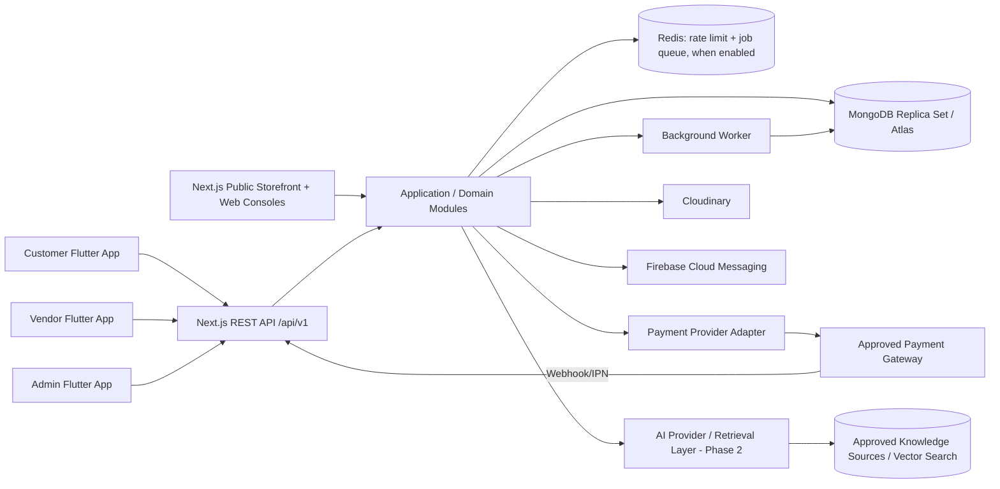
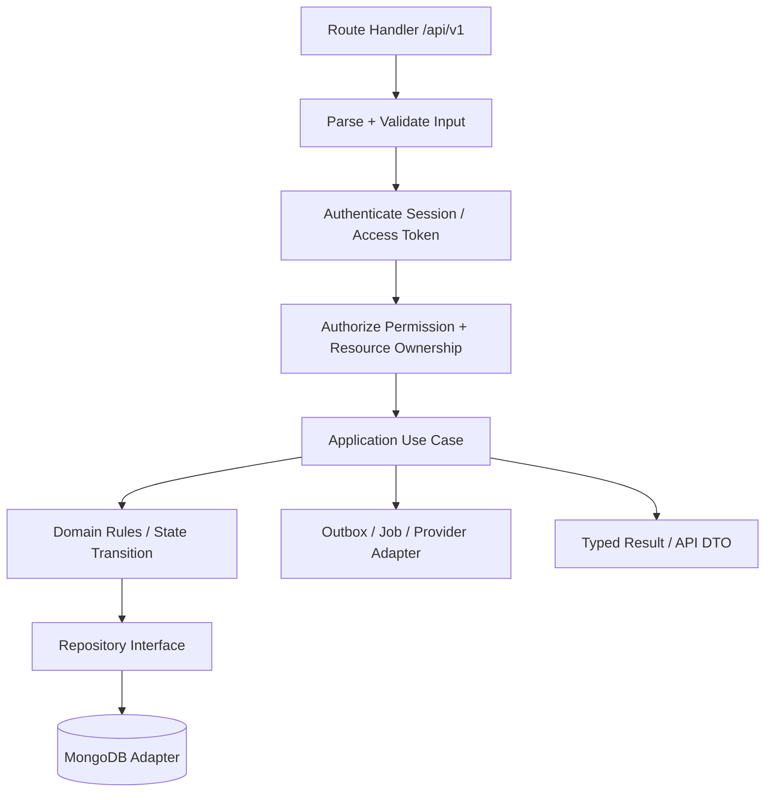

# 02 — System Architecture

## 1. Architecture choice

Use a **modular monolith** for the first production release. One Next.js deployment contains the public website, admin/vendor web consoles and versioned REST API, but the code is separated into domain modules with explicit dependencies. This keeps early operational overhead low while preserving boundaries that can later be extracted if real scaling or team ownership demands it.

Do not start with microservices, event sourcing everywhere or Kubernetes merely because the reference platforms are large. Establish correct domain invariants, metrics and tests first.

## 2. Context diagram



## 3. Proposed repository layout

```text
marketplace/
  apps/
    web/                         # Next.js App Router: storefront, admin, vendor, API
    mobile-customer/             # Flutter app
    mobile-vendor/               # Flutter app
    mobile-admin/                # Flutter app
  packages/
    contracts/                   # OpenAPI spec, generated client artifacts if needed
    design-tokens/               # Web tokens/source; Dart tokens generated or mirrored via script
  mobile_packages/
    app_core/                    # Shared Flutter networking, secure session, error types
    design_system/               # Shared Flutter theme/widgets
    observability/               # Firebase wrappers and event naming
  docs/                          # This specification pack; keep it maintained
  scripts/                       # Mongo indexes/migrations, seed, release/check scripts
  .github/workflows/             # CI checks per changed area
```

Do not try to import TypeScript domain code into Dart or share runtime logic across languages. Share contracts and behavioural definitions, generate or validate client types, and keep language-native domain implementations small and aligned.

## 4. Web rendering policy

| Page/area | Default rendering approach | Reason / constraint |
|---|---|---|
| Home, public categories, public product detail, vendor storefront | Server-rendered or statically/ISR cached where safe | SEO, initial performance; cache invalidation must follow catalog publication |
| Search results | Server-rendered initial query plus client interactions, depending on UX | Preserve shareable URLs and metadata; validate filters/limits on server |
| Cart | Dynamic and user/session-aware | Never shared-cache a user's cart |
| Checkout and payment initiation/result | Dynamic, no shared cache | Sensitive, stateful, provider callbacks and idempotency |
| Customer account/orders | Authenticated dynamic data | Verify identity and ownership on each request |
| Vendor console | Authenticated dynamic console shell; query only authorized vendor scope | Data isolation is mandatory |
| Admin console | Authenticated, permission-specific dynamic pages | Least privilege, no accidental public cache |
| API Route Handlers | Explicit request validation, auth, rate limits and cache headers | REST API consumed by Flutter; private responses normally `Cache-Control: no-store` |

CSR is appropriate for interactive filters, tables, editors and local state. SSR is not an authorization mechanism. Do not cache private data across users. Apply current Next.js caching APIs deliberately and add cache tags/invalidation for published catalog changes.

## 5. Request and module flow



Route handlers are transport adapters, not the place for business rules. They should parse/validate input, invoke a use case, map a typed outcome to an HTTP response and attach request/correlation metadata. The web interface must call server-side use cases for server-rendered pages; browser-side clients and mobile apps call versioned endpoints. Do not implement the same transaction twice in a Server Action and a REST route.

## 6. Suggested business modules

- `identity`: accounts, contact verification, sessions, refresh-token rotation, recovery.
- `authorization`: roles, permissions, policy evaluation, ownership checks.
- `vendors`: applications, status, store profile, seller settings, payout onboarding state.
- `catalog`: categories, products, variants, moderation, attributes, media references.
- `pricing`: price rules, coupons and commission configuration; all currency-safe.
- `inventory`: SKU quantity, reservation, release, adjustment and audit.
- `cart`: customer/guest cart, merge strategy, price/availability refresh.
- `checkout`: shipping quote, address validation, order preview and idempotent checkout creation.
- `orders`: parent order, vendor orders, state transitions, cancellations and returns.
- `payments`: provider adapters, payment attempts, webhook/IPN validation, refunds.
- `ledger`: immutable vendor payable/commission/refund/payout accounting entries.
- `fulfillment`: shipment details, carrier integration abstraction and tracking events.
- `reviews`: verified purchase checks, moderation and seller/product summaries.
- `notifications`: in-app/inbox plus email/SMS/FCM adapters; durable retries.
- `admin`: application orchestration and audit, not a separate domain with unrestricted DB access.
- `support-ai`: phase-2 retrieval, citations and permitted read-only support tools.

Each module owns its application services and repository interfaces. Cross-module writes should be explicit application orchestration, not undocumented direct database writes.

## 7. Design patterns — intentional use, not checkbox use

At least these patterns must appear where they solve a real problem:

1. **Repository:** `ProductRepository`, `OrderRepository`, `SessionRepository` isolate MongoDB from use cases and permit deterministic tests.
2. **Strategy:** shipping fee calculation, commission policy, inventory reservation policy, sorting/ranking or payment-method selection can vary behind interfaces.
3. **Adapter:** each payment gateway, Cloudinary, FCM and AI provider implements an internal interface while hiding third-party request/response semantics.
4. **Factory / Registry:** select a payment adapter by configured provider ID and environment; reject unknown or disabled providers.
5. **State pattern / explicit state machines:** order, payment, vendor application, refund and payout transitions have enumerated states and allowed transition functions. Do not scatter string comparisons across UI/routes.
6. **Specification / Policy:** eligibility rules for coupons, vendor publishing, returns and permissions are composable and testable.
7. **Unit of Work / transaction boundary:** use-case orchestration coordinates a MongoDB session/transaction for multi-document invariants; do not hide transactions inside random repositories.
8. **Outbox + idempotent consumer:** record durable events with the main database change, then asynchronously send notifications/jobs without losing them between commit and queue publish.

## 8. SOLID rules

- **S:** one module/class/function has one coherent reason to change.
- **O:** add a provider by implementing its adapter and registering it; do not edit checkout rules throughout the codebase.
- **L:** implementations honour the same contract and error semantics. Provider-specific quirks are mapped inside the adapter.
- **I:** keep interfaces small (e.g. charge/verify/refund capabilities instead of one giant provider interface when capabilities vary).
- **D:** application use cases depend on domain contracts; infrastructure implementations are injected at composition boundaries.

SOLID does not mean creating an interface for every one-line utility. Use abstractions at unstable boundaries and business policies.

## 9. Resilience and scaling path

- Horizontal web/API scaling with stateless application instances; durable sessions and idempotency state live outside process memory.
- CDN/cache public content only; invalidate product/category/vendor page caches on publish/update.
- Background queue for notifications, emails, feed updates and AI ingestion. Use retries with jitter, maximum attempts, dead-letter/manual review and idempotent workers.
- Redis may be used for distributed rate limiting, short-lived cache and queue transport; MongoDB remains the source of truth for orders/payments/ledger.
- Add MongoDB indexes from measured query shapes; use pagination and projections. Avoid unbounded arrays and broad unindexed regex searches.
- Add provider timeout/retry rules; a timeout after charge initiation is an **unknown** state requiring verification, not immediate duplicate charge.
- Extract a module to a service only after measuring a bottleneck or needing an independent reliability/security boundary. Keep event contracts explicit if that happens.
