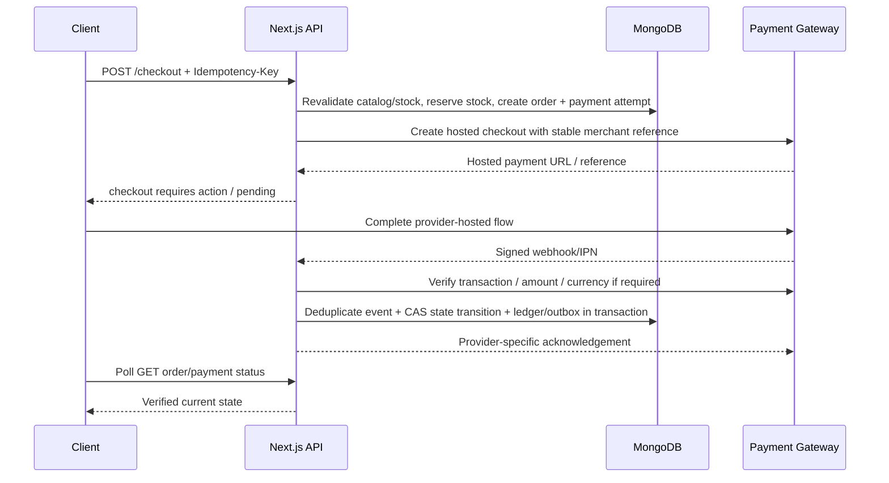

# 06 — Checkout, Payment Providers and Vendor Settlement

## 1. Separate four concepts

1. **Checkout/order creation:** validate basket, prices, stock, delivery, discounts and seller status; create durable order records.
2. **Payment collection:** customer pays the marketplace's contractually approved merchant account through a configured provider.
3. **Fulfillment:** each vendor accepts/picks/ships/delivers their vendor order independently.
4. **Vendor settlement:** compute and pay the vendor's payable balance through a compliant, approved mechanism.

A successful payment does not mean all items shipped. A shipped item does not change payment state. A ledger amount does not automatically mean a provider has moved money to a vendor's bank.

## 2. Critical marketplace payment caveat

Do **not** assume a normal checkout gateway supports multi-vendor split payments, seller onboarding/KYC, marketplace payouts, escrow or regulated money movement. Bangladesh merchant eligibility, settlement model, provider contracts and local legal/regulatory requirements must be confirmed directly before launch. A generic gateway can collect customer funds without giving the platform permission or tooling to disburse seller proceeds.

For initial MVP, model seller payables using an immutable internal ledger and an operations-controlled, reconciled payout workflow only if the business's legal/payment arrangement permits it. Automate vendor payouts or adopt a provider marketplace product only when its supported countries, account types, KYC model, payout rails, fees, chargeback liability and contractual use case have been confirmed.

## 3. Provider adapter interface

Define a provider-neutral contract around business capabilities. Do not leak provider-specific fields into domain use cases.

```ts
export type PaymentProviderId = string;
export type PaymentStatus =
  | "created" | "requires_action" | "pending" | "succeeded"
  | "failed" | "cancelled" | "refunding" | "partially_refunded" | "refunded" | "unknown";

export interface PaymentProviderAdapter {
  readonly id: PaymentProviderId;
  createCheckout(input: CreateCheckoutInput): Promise<CreateCheckoutResult>;
  getPaymentStatus(input: VerifyPaymentInput): Promise<VerifiedPaymentStatus>;
  parseAndVerifyWebhook(request: Request): Promise<VerifiedProviderEvent>;
  refund?(input: RefundInput): Promise<RefundResult>;
  capabilities(): PaymentProviderCapabilities;
}
```

Use capability flags for refunds, partial refunds, webhook signatures, hosted checkout, supported currencies, recurring/tokenized methods, and marketplace payout support. The absence of a capability must cause the relevant feature to be unavailable, not silently simulated.

Implement:
- `PaymentProviderRegistry` / factory from validated server configuration.
- One provider adapter at a time behind contract tests; add the next only after its sandbox flow works.
- Normalized internal errors (`declined`, `provider_unavailable`, `configuration_error`, `unknown_result`, `verification_failed`) and safe diagnostic logs.
- Provider credentials/environment are resolved server-side only. Never provide arbitrary provider endpoint URLs from user input.

## 4. Checkout and payment flow



Detailed rules:
1. Require an idempotency key on checkout. Recalculate all totals server-side from live catalog/rules.
2. Reserve inventory using conditional DB writes. If reservation fails, abort checkout with a safe conflict response.
3. Persist an order and payment attempt in `pending`/`created` before the external provider call, with a stable merchant reference.
4. Do not hold a MongoDB transaction open during a gateway network call.
5. If provider initiation returns a timeout/unknown outcome, query by merchant reference before deciding whether to retry.
6. A return URL only tells the client to refresh order status. It is not authoritative proof of payment.
7. On webhook/IPN, authenticate/verify the event and compare provider, merchant reference, order, amount, currency and allowed state transition.
8. Deduplicate event and process the state transition in a short transaction. Write durable outbox events for notifications and other side effects.
9. Duplicate or out-of-order callbacks must not double-commit stock, ledger entries, email/FCM notifications or refunds.
10. Reconcile stuck `pending`/`unknown` payments with a scheduled job and operator queue. Never create a second charge as a blind response to timeout.

## 5. Payment, order and refund states

Payment status proposal:
- `created`
- `requires_action`
- `pending`
- `succeeded`
- `failed`
- `cancelled`
- `unknown` (provider result is ambiguous; reconciliation required)
- `partially_refunded`
- `refunded`

Order and vendor-order states are separate: `pending_payment`, `paid`, `processing`, `partially_fulfilled`, `shipped`, `delivered`, `cancelled`, `return_requested`, `returned`, `closed` as approved by the domain state machine. Do not assume every transition can be made by every role.

Refunds are first-class records with reason, scope, requested/approved actor, amount, currency, provider result and ledger reversal entries. Use partial-refund-safe accounting; check cumulative refunds against refundable amount and handle payment-provider refund timeouts with reconciliation.

## 6. Seller ledger and settlement model

Define ledger entry types before coding, for example:
- `sale_gross`
- `platform_commission`
- `payment_fee` (only when the fee allocation policy is explicit)
- `shipping_adjustment`
- `discount_subsidy`
- `refund_debit`
- `chargeback_debit`
- `payout_debit`
- `manual_adjustment` (permission + reason + audit; preferably maker-checker)
- `reversal`

Each row contains vendor, related order/vendor order/payment/refund/payout IDs, currency, signed minor-unit amount, idempotency reference, rule version, actor/system source and timestamp. Do not overwrite ledger entries. Do not present pending payable as “paid out”.

Vendor settlement statuses should distinguish `not_eligible`, `available`, `requested`, `under_review`, `approved`, `processing`, `paid`, `failed`, `cancelled` and `reconciliation_required`, subject to final policy.

## 7. Provider shortlist to evaluate

### Bangladesh-first candidates (confirm current contracts and sandbox access)
- **SSLCOMMERZ:** official developer portal has a sandbox and documents session creation, IPN and order-validation workflows.
- **aamarPay:** public developer reference describes a sandbox environment; credentials and live merchant eligibility must be confirmed.
- **shurjoPay:** official developer documentation describes sandbox APIs and merchant-issued live credentials.
- **bKash PGW:** an official demo merchant portal lists sandbox checkout/tokenized checkout flows; obtain the current merchant integration docs and confirm your commercial use case.
- **Nagorikpay:** public docs describe test/sandbox API credentials. Evaluate reliability, merchant onboarding, method coverage and compliance; don't imply endorsement.
- **Nagad / other bank or MFS integrations:** request the current official merchant/developer documentation directly. Do not use unofficial GitHub code or assume access to a public sandbox is an authorized production integration.

### Global candidates (not automatically available to a Bangladesh-incorporated platform)
- **PayPal:** has a sandbox environment, but merchant-country eligibility and ability to receive/withdraw funds must be independently confirmed.
- **Stripe:** has a test mode and broad international customer coverage, but its merchant-account country list and cross-country entity requirements matter. A sandbox working is not proof that a Bangladesh business can open a supported live account.
- **Adyen / Checkout.com:** have test/sandbox resources and marketplace-related products, but onboarding is contract-driven and supported merchant/seller countries are restricted. Treat as later candidates after a written eligibility check.
- Other providers (e.g. Razorpay) should be evaluated only after confirming business-country eligibility, cross-border policy and actual supported currencies/methods.

Do not promise “all global gateways”. Create a provider inventory with columns: country of platform legal entity, seller-country support, shopper-country support, collection currencies, settlement currencies, payout support, marketplace/sub-merchant support, refund/chargeback capabilities, sandbox quality, live onboarding status and signed commercial approval.

## 8. Payment go-live checklist

- Written provider approval for the platform/business model and marketplace context.
- Confirmed legal entity, merchant account, account owner and settlement bank details.
- Sandbox credentials obtained through official channels and kept in secret storage.
- Full checkout tests: success, decline, cancellation, timeout, duplicate callback, invalid signature, mismatched amount/currency, delayed confirmation, refund, partial refund and reconciliation.
- Webhook endpoint public over TLS, provider-specific verification, replay/deduping and monitoring.
- Settlement/commission/chargeback policy approved; vendor statements are reconcilable from immutable ledger data.
- Live launch protected by feature flag and provider-specific operational runbook; test/live configs cannot be mixed.
