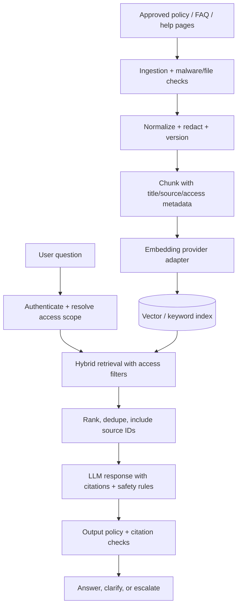

# 09 — AI Integration and Knowledge Base (Phase 2)

## 1. AI use cases to consider

Start with bounded, low-risk use cases:
- customer support assistant answering from published FAQ, shipping, return, payment and platform policy content;
- admin/vendor helper that drafts product descriptions or summarizes a review queue, always requiring human approval before publishing or changing catalog data;
- semantic product search only after product metadata quality and relevance evaluation are established.

Do not start with an agent that can autonomously issue refunds, change seller balances, approve accounts or edit orders. Commerce writes remain governed by deterministic use cases and permissions.

## 2. Knowledge pipeline

Knowledge entries should have: source ID/URL, owning team, content type, version/hash, effective date, visibility/access scope, locale, approval status, ingestion status and retention policy. Re-ingest on approved source changes; unpublish/revoke stale content and invalidate the index.

## 3. Retrieval and tenant/security controls

- Authorize before retrieving; filter by allowed public/private/tenant scope before passing documents to the model. Do not retrieve then trust the model to omit private vendor/customer data.
- Vendor-private content is filtered by authenticated vendor ID. Admin-only material requires the right permission. Customer order details are fetched through narrowly scoped backend tools, not embedded indiscriminately in the knowledge base.
- Treat source documents, retrieved text and user input as untrusted data, not instructions. Defend against prompt injection and tool manipulation.
- Keep the system prompt separate from retrieved text. Delimit sources, limit tool set, validate tool inputs and never expose secrets/system prompts.
- Cite source title/link/version for policy answers. If evidence is insufficient or contradictory, state uncertainty and route to support rather than inventing a rule.
- Put a human confirmation boundary before any financial, account, product publication or operational write action. Prefer read-only support tools in MVP.

## 4. RAG implementation boundaries

- Define interfaces such as `EmbeddingProvider`, `KnowledgeIndex`, `Retriever`, `LLMProvider`, `SafetyPolicy` and `SupportToolRegistry`.
- Keep model/provider credentials and requests server-side. Add timeout, retry, rate limits, budget/token limits and provider fallback behaviour.
- Choose MongoDB Atlas Vector Search or another vector store based on deployment availability, filtering needs, cost and evaluation; do not assume any deployment tier has a given capability without checking.
- Store source records and ingestion state in MongoDB. Vector index is a derived index that can be rebuilt; it must not be treated as the legal source of truth.
- Record prompt/model/version, retrieval source IDs, latency, token/cost usage and outcome in privacy-safe telemetry. Do not log raw conversations by default without a documented purpose/consent/retention plan.

## 5. Evaluation before launch

Build a benchmark set of real approved support questions, edge cases, ambiguous questions, stale/contradictory content, prompt injection attempts and cross-vendor data-leak attempts. Score answer correctness, citation support, refusal/escalation quality, retrieval precision, latency and cost. Include red-team tests before allowing the feature to customer-facing production.

## 6. AI acceptance criteria

- Every policy answer links back to approved source material or clearly says it cannot verify the answer.
- Query results cannot cross user/vendor/admin data boundaries.
- No model can directly invoke arbitrary URLs, database queries, payments or unrestricted server functions.
- An unavailable AI provider produces a clean fallback, not a broken checkout/support screen.
- Admin/vendor generated content remains draft until a human explicitly publishes it.
- User data is sent only to the configured model/provider after the data-handling/retention terms have been reviewed.
